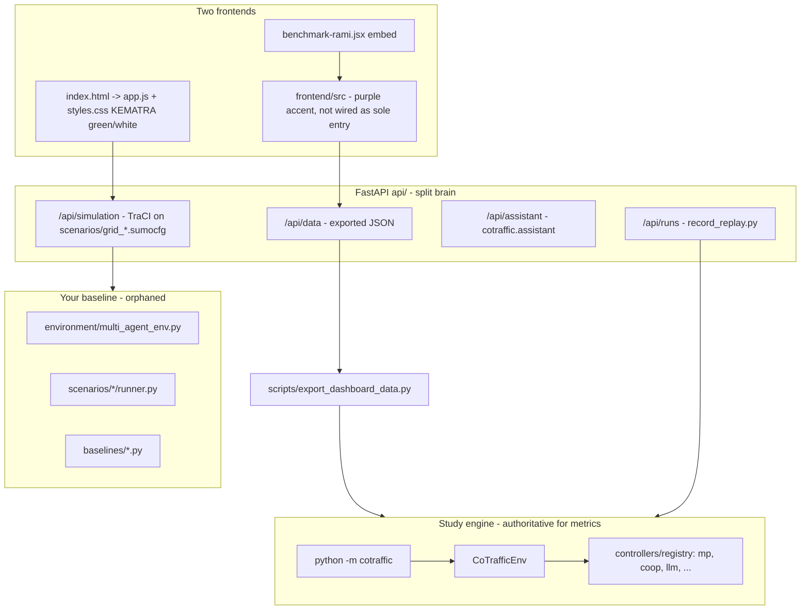
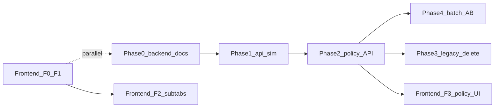

# KEMETRA backend consolidation and A/B roadmap

## Current problem (why it feels like a mess)

Three stacks coexist without a documented boundary:




**Target:** one backend domain (`cotraffic`) + one thin HTTP layer (`api/`) + one settings-driven **control policy** (RL learned vs LLM vs baseline) for live runs and scenario launches.

**Frontend (separate plan):** See **[Frontend benchmark UI plan](frontend_benchmark_ui_05911eba.plan.md)** (Cursor plans) and repo **[docs/FRONTEND_ROADMAP.md](docs/FRONTEND_ROADMAP.md)** (created in frontend F0). Backend plan only defines API contracts the UI calls.

---

## Deliverable: master documentation MD

Create `**[docs/ARCHITECTURE.md](docs/ARCHITECTURE.md)**` (primary artifact you asked for) with:


| Section            | Content                                                                                                             |
| ------------------ | ------------------------------------------------------------------------------------------------------------------- |
| Purpose            | Single source of truth; who owns what (simulation vs dashboard demo vs study results)                               |
| Layer diagram      | CLI, API, export pipeline, frontend data sources (`mock` / `live`)                                                  |
| Controller catalog | Table mapping UI labels → `method` strings → checkpoint requirements → LLM env vars                                 |
| Runbooks           | Train → select → evaluate → export → start API → open dashboard                                                     |
| A/B protocol       | `[configs/experiments/llm_ab.yaml](configs/experiments/llm_ab.yaml)` + fairness notes (5 s RL vs 30 s LLM interval) |
| Deprecation        | Legacy paths marked **removed after Phase 3** with checklist                                                        |
| Frontend           | Link to [docs/FRONTEND_ROADMAP.md](docs/FRONTEND_ROADMAP.md) (not duplicated here)                                  |


Add `**[docs/MIGRATION_CHECKLIST.md](docs/MIGRATION_CHECKLIST.md)**` as a gate before deleting legacy code (checkboxes tied to tests below).

Update stale docs in the same pass: `[README.md](README.md)` (point to `cotraffic` + `api/`), `[frontend/README.md](frontend/README.md)` (backend exists; proxy on 8000).

---

## Phase 1 — Backend source of truth (no UI break)

**Rule:** Anything that moves vehicles or chooses signal phases for the product goes through `**make_controller` + `CoTrafficEnv` + shield** (`[src/cotraffic/evaluation/runner.py](src/cotraffic/evaluation/runner.py)`).

### 1.1 Reorganize `api/` (structure only, same URLs first)

Split `[api/main.py](api/main.py)` into routers so the HTTP layer stays thin:

- `api/routes/data.py` — `GET /api/data/{path}`
- `api/routes/assistant.py` — status + SSE chat
- `api/routes/runs.py` — run queue (keep `[api/runs.py](api/runs.py)` logic)
- `api/routes/simulation.py` — live sim (rewritten in 1.2)
- `api/routes/policy.py` — **new**: read/write active control policy (see 1.3)
- `api/main.py` — app factory, CORS, mount routers

Add `**api/README.md**` one page: how to run `uvicorn api.main:app --port 8000` and env vars.

### 1.2 Replace legacy live simulation

Today `[api/simulation.py](api/simulation.py)` starts TraCI on `[scenarios/grid_2x2/grid2x2.sumocfg](scenarios/grid_2x2/grid2x2.sumocfg)` with **SUMO default programs** — not comparable to RL/LLM.

**Rewrite** `SimulationSession` to:

1. Map API scenario ids → `cotraffic` network names (`grid-2x2` → `grid2x2`, `grid-3x3` → `grid3x3` via `[configs/networks/grid2x2.yaml](configs/networks/grid2x2.yaml)`).
2. On `start`, build `make_controller(active_method, checkpoint)` from server-side policy state.
3. Run the same loop as `run_episode`: `reset` → `while env.agents: act → step` in a background thread, publishing snapshots for `[frontend/app.js](frontend/app.js)` / `[frontend/sumo-env.js](frontend/sumo-env.js)` (vehicles, signals, time).
4. Keep response shape stable for `app.js` (`simulationTime`, `vehicles`, `signals`, `status`) to avoid breaking the 3D map initially.

Optional follow-up (Phase 4): extend to `grid4x4` / `real_district` once perf is acceptable.

### 1.3 Control policy API + config (RL vs LLM toggle backend)

Introduce a small **server-side policy** object (in-memory + optional persist file e.g. `results/dashboard_policy.json`):

```yaml
# configs/dashboard_policy.yaml (defaults)
live:
  method: mp          # registry name: mp | coop | llm | ft | ...
  checkpoint: auto    # resolve via cotraffic.paths.default_checkpoint
  llm:
    provider: groq    # mirrors COTRAFFIC_LLM_* env
    call_interval_s: 30
```

**New endpoints:**

- `GET /api/policy` — current method, availability (checkpoint exists? LLM reachable?)
- `PUT /api/policy` — validate against `[src/cotraffic/controllers/registry.py](src/cotraffic/controllers/registry.py)`; reject learned methods without checkpoint

Wire `[scripts/record_replay.py](scripts/record_replay.py)` / `[api/runs.py](api/runs.py)` so dashboard “left/right” picks can default from policy presets (e.g. `coop` vs `llm`) without hardcoding.

### 1.4 Single Python package boundary

- `**src/cotraffic/**` = domain (env, controllers, train, evaluate, metrics, assistant).
- `**api/**` = HTTP adapter only (no duplicate TraCI logic).
- `**scripts/**` = CLI wrappers calling `cotraffic` (export, replay, reproduce).

Document that `**python -m cotraffic**` remains the batch/research entry; `**api/**` is for the dashboard and live demo.

---

## Phase 2 — Control policy API (backend)

Implement server-side policy (see 1.3) and document the contract for the frontend plan **F3**:

- `GET /api/policy` — method, availability flags
- `PUT /api/policy` — validate against registry; reject missing checkpoints

**UI for RL vs LLM toggle:** frontend plan F3 (`settings/store`, Settings page, i18n). Do not duplicate UI tasks here.

**Important:** Assistant `llmProvider` vs control LLM env vars — document both in ARCHITECTURE.md.

---

## Phase 3 — Legacy removal (after migration gate)

Delete when `[docs/MIGRATION_CHECKLIST.md](docs/MIGRATION_CHECKLIST.md)` is complete:


| Remove                                                                   | Replace with                                                                |
| ------------------------------------------------------------------------ | --------------------------------------------------------------------------- |
| `[environment/multi_agent_env.py](environment/multi_agent_env.py)`       | `CoTrafficEnv`                                                              |
| `[baselines/](baselines/)`                                               | `cotraffic.controllers.classical`                                           |
| `[evaluation/benchmark_baselines.py](evaluation/benchmark_baselines.py)` | `cotraffic evaluate`                                                        |
| `[agents/rl/*.py](agents/rl/dqn_agent.py)` stubs                         | SB3 in `[src/cotraffic/training/train.py](src/cotraffic/training/train.py)` |
| Tests importing `SumoMARLEnv`                                            | Rewrite to `CoTrafficEnv` smoke tests or drop if redundant                  |


Keep **scenario folders** `[scenarios/grid_2x2](scenarios/grid_2x2)` as SUMO assets until networks are fully generated from `[configs/networks/](configs/networks/)` only; runners may be deleted if unused after live sim rewrite.

**Tests to add/update before deletion:**

- API policy validation (learned without checkpoint → 422)
- Live sim starts with `method=llm` and falls back to MP when no API key (existing controller behavior)
- Regression: `cotraffic evaluate --experiment llm_ab_quick` (or smoke)

---

## Phase 4 — A/B benchmarking workflow (RL vs LLM)

**Batch (study-quality)** — already mostly implemented:

1. Train: `python -m cotraffic train --agent coop --net grid2x2 --seed 0` (repeat seeds/networks)
2. Select: `python -m cotraffic select --agent coop --net grid2x2 --seed 0`
3. Evaluate: `python -m cotraffic evaluate --experiment llm_ab`
4. Export: `python scripts/export_dashboard_data.py`
5. Analyze: dashboard Analytics + `cotraffic aggregate` / figures

Document fairness constraints in ARCHITECTURE.md (decision interval, observation mismatch coop vs LLM prompt).

**Interactive (dashboard)** — after backend Phase 2 + frontend F3 (policy UI).

---

## Suggested execution order



**Parallel tracks:** Frontend F0–F2 (benchmark UI) does not block backend Phase 1. Frontend F3 waits on policy API.

Batch A/B (Phase 4) can run once checkpoints exist, independent of legacy deletion.

---

## Risk controls

- **Live sim rewrite:** keep old `api/simulation.py` behind env flag `KEMETRA_LEGACY_SIM=1` for one sprint, then remove.
- **Styling:** change tokens only first; avoid mass component rewrites until accent variables are green.
- **LLM cost:** respect `max_calls` in `[configs/agents/llm.yaml](configs/agents/llm.yaml)` for dashboard live mode defaults.

---

## Success criteria

- One documented backend: all control paths use `cotraffic` controllers + shield.
- Dashboard live sim reflects selected policy (RL checkpoint or LLM), not raw sumocfg defaults.
- Settings toggle persists and drives API policy.
- `llm_ab` experiment reproducible from docs runbook.
- Legacy Python stack deleted with passing tests.
- Frontend success criteria: see **Frontend benchmark UI plan**.

