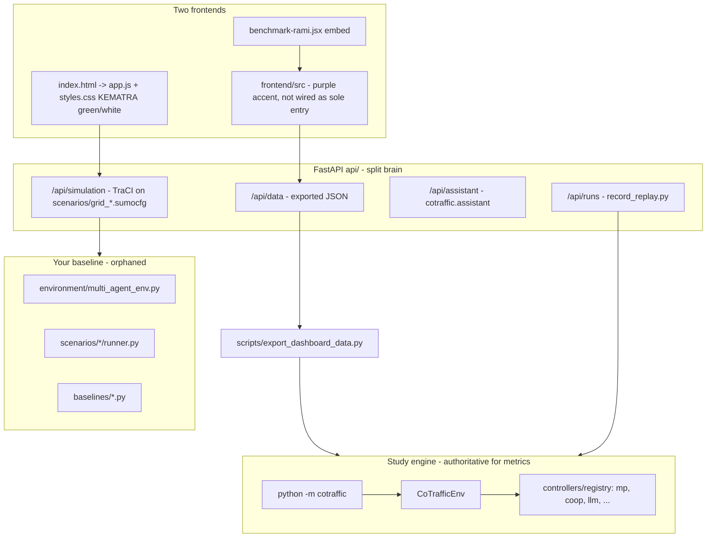
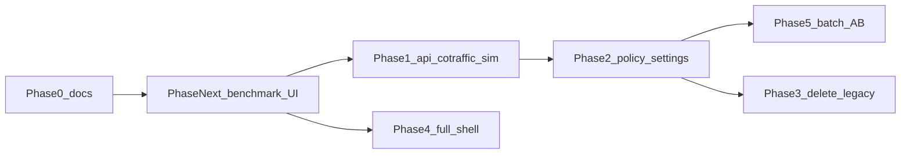

# KEMETRA backend consolidation and A/B roadmap

## Current problem (why it feels like a mess)

Three stacks coexist without a documented boundary:




**Target:** one backend domain (`cotraffic`) + one thin HTTP layer (`api/`) + one visual system (KEMATRA `[frontend/styles.css](frontend/styles.css)`) + one settings-driven **control policy** (RL learned vs LLM vs baseline) for live runs and scenario launches.

---

## Deliverable: master documentation MD

Create `**[docs/ARCHITECTURE.md](docs/ARCHITECTURE.md)**` (primary artifact you asked for) with:


| Section            | Content                                                                                                             |
| ------------------ | ------------------------------------------------------------------------------------------------------------------- |
| Purpose            | Single source of truth; who owns what (simulation vs dashboard demo vs study results)                               |
| Layer diagram      | CLI, API, export pipeline, frontend data sources (`mock` / `live`)                                                  |
| Controller catalog | Table mapping UI labels → `method` strings → checkpoint requirements → LLM env vars                                 |
| Runbooks           | Train → select → evaluate → export → start API → open dashboard                                                     |
| A/B protocol       | `[configs/experiments/llm_ab.yaml](configs/experiments/llm_ab.yaml)` + fairness notes (5 s RL vs 30 s LLM interval) |
| Deprecation        | Legacy paths marked **removed after Phase 3** with checklist                                                        |
| Frontend           | KEMATRA design tokens vs removed purple theme                                                                       |


Add `**[docs/MIGRATION_CHECKLIST.md](docs/MIGRATION_CHECKLIST.md)**` as a gate before deleting legacy code (checkboxes tied to tests below).

Update stale docs in the same pass: `[README.md](README.md)` (point to `cotraffic` + `api/`), `[frontend/README.md](frontend/README.md)` (backend exists; proxy on 8000).

---

## Phase Next — Benchmark and subtabs UI reform (immediate priority)

**Goal:** When the operator opens **Benchmark** in the main KEMATRA shell (`[frontend/app.js](frontend/app.js)` → `#benchmarkView`), the four subtabs (Vue d’ensemble, Agents RL, Carte en direct, Analyse comparative) must look like the **main overview dashboard**: green accent (`#7cbd40` / `#70b83a`), white **glassmorphism** cards, Outfit/light surfaces — **not** the current purple/dark cotraffic skin from `[benchmark-rami.jsx](frontend/benchmark-rami.jsx)` (`rami-migrated-shell`, `bg-bg` dark tokens).

**Visual system (single recipe):**

- **Reference UI:** Overview tab in the main dashboard — `[frontend/styles.css](frontend/styles.css)` benchmark block (`.benchmark-card`, `.benchmark-tab.is-active`, green eyebrow) **plus** React `[Panel](frontend/src/shared/ui/panel.tsx)` / `[PageHeader](frontend/src/shared/ui/page-header.tsx)` on `[OverviewPage.tsx](frontend/src/features/overview/OverviewPage.tsx)`.
- **Component library:** Keep **@astryxdesign/core** (Button, Card, Layout) via `Panel` / `KButton` — do **not** remove Astryx; **re-map tokens** in `[astryx-tokens.css](frontend/src/shared/theme/astryx-tokens.css)` and `[index.css](frontend/src/shared/theme/index.css)` so `--color-accent`, `--color-text-accent`, `--accent`, `--accent-soft` use **green**, surfaces use **white/light glass** (`rgba(255,255,255,.85)`, hairline `#e2e7df` borders), matching `[styles.css](frontend/styles.css)` `:root` (`--green`, white background).
- **Explicitly remove:** Purple values (`#9a8cff`, `#5b4bd6`, `#b3a8ff`), default **dark** `[data-theme="dark"]` chrome inside the benchmark mount, and the duplicate tab strip styling that fights kematra `.benchmark-tabs`.

**Backend integration (same data as study, no second truth):**

- Benchmark mount must use the same pipeline as the full React app: `[Providers](frontend/src/app/providers.tsx)` + TanStack Query + `[fetchData](frontend/src/shared/api/source.ts)` / `[queries.ts](frontend/src/shared/api/queries.ts)`.
- Default **live** when entering benchmark (today’s `LiveDataMode` hack in `benchmark-rami.jsx`) becomes explicit UX: respect `[settings.dataSource](frontend/src/features/settings/store.ts)` with a visible badge (mock = exported JSON in `public/data`; live = `GET /api/data/*` via Vite proxy → port 8000).
- Subtab **Carte en direct**: keep map-specific **dark glass** only over the Mapbox canvas (as in live-map Events tab); analytics/overview/agents stay **light green glass**.
- Optional in this phase: poll `GET /api/runs` + `GET /api/health` on Agents/Overview footers (no policy API yet — that stays Phase 1 backend).

**Implementation steps (ordered):**

1. **Design tokens first** — Update light theme in `index.css` + `astryx-tokens.css` (green accent, white glass surfaces); set `[charts/tokens.ts](frontend/src/shared/charts/tokens.ts)` accent to green. Force benchmark root to `data-theme="light"` and `data-astryx-theme="kemetra"`.
2. **Replace embed shell** — Retire `[benchmark-rami.jsx](frontend/benchmark-rami.jsx)` as the long-term pattern; add `[frontend/src/features/benchmark/BenchmarkShell.tsx](frontend/src/features/benchmark/BenchmarkShell.tsx)` (or similar) that:
   - Renders kematra-aligned subtab nav (reuse CSS classes from `styles.css` **or** Tailwind tokens mirroring them).
   - Switches among `OverviewPage`, `AgentsPage`, `LiveMapPage`, `AnalyticsPage` without a second Provider tree.
   - Exports `mountBenchmark(container)` for `app.js` (same integration point, new implementation).
3. **Restyle subtabs** — Pass on each page: ensure `Shell`-less pages use `Panel`/`ChartCard`/`KpiCard` consistently; fix `[Sidebar](frontend/src/app/layout/Sidebar.tsx)`-style active states to green (`bg-accent-soft` once accent is green). Remove purple from assistant chat bubbles in benchmark context if needed.
4. **Nav sync** — Wire `[app.js](frontend/app.js)` `benchmarkSubnav` clicks to React tab state (custom event or shared `localStorage` key `kemetra.benchmarkTab`) so sidebar subtabs and in-view tabs stay one source.
5. **Cleanup** — Remove `rami-migrated-shell` class; audit `[benchmark-live.jsx](frontend/benchmark-live.jsx)` for duplicate fetch logic; delete dead purple CSS in `index.css` `[data-theme="dark"]` **only for benchmark scope** if full app still needs dark elsewhere (document split: *dashboard pages = light*, *map overlay = dark glass*).
6. **Verify** — Manual: mock mode (no uvicorn) shows same numbers as before; live mode with `uvicorn api.main:app` shows `/api/data/meta` + summary; visual check against main overview dashboard.

**Out of scope for Phase Next (later phases):** cotraffic-backed live sim rewrite (Phase 1.2), RL/LLM policy toggle (Phase 2), deleting `app.js` (frontend-entry todo).

---

## Phase 1 — Backend source of truth (no UI break)

**Rule:** Anything that moves vehicles or chooses signal phases for the product goes through `**make_controller` + `CoTrafficEnv` + shield** (`[src/cotraffic/evaluation/runner.py](src/cotraffic/evaluation/runner.py)`).

### 1.1 Reorganize `api/` (structure only, same URLs first)

Split `[api/main.py](api/main.py)` into routers so the HTTP layer stays thin:

- `api/routes/data.py` — `GET /api/data/{path}`
- `api/routes/assistant.py` — status + SSE chat
- `api/routes/runs.py` — run queue (keep `[api/runs.py](api/runs.py)` logic)
- `api/routes/simulation.py` — live sim (rewritten in 1.2)
- `api/routes/policy.py` — **new**: read/write active control policy (see 1.3)
- `api/main.py` — app factory, CORS, mount routers

Add `**api/README.md**` one page: how to run `uvicorn api.main:app --port 8000` and env vars.

### 1.2 Replace legacy live simulation

Today `[api/simulation.py](api/simulation.py)` starts TraCI on `[scenarios/grid_2x2/grid2x2.sumocfg](scenarios/grid_2x2/grid2x2.sumocfg)` with **SUMO default programs** — not comparable to RL/LLM.

**Rewrite** `SimulationSession` to:

1. Map API scenario ids → `cotraffic` network names (`grid-2x2` → `grid2x2`, `grid-3x3` → `grid3x3` via `[configs/networks/grid2x2.yaml](configs/networks/grid2x2.yaml)`).
2. On `start`, build `make_controller(active_method, checkpoint)` from server-side policy state.
3. Run the same loop as `run_episode`: `reset` → `while env.agents: act → step` in a background thread, publishing snapshots for `[frontend/app.js](frontend/app.js)` / `[frontend/sumo-env.js](frontend/sumo-env.js)` (vehicles, signals, time).
4. Keep response shape stable for `app.js` (`simulationTime`, `vehicles`, `signals`, `status`) to avoid breaking the 3D map initially.

Optional follow-up (Phase 4): extend to `grid4x4` / `real_district` once perf is acceptable.

### 1.3 Control policy API + config (RL vs LLM toggle backend)

Introduce a small **server-side policy** object (in-memory + optional persist file e.g. `results/dashboard_policy.json`):

```yaml
# configs/dashboard_policy.yaml (defaults)
live:
  method: mp          # registry name: mp | coop | llm | ft | ...
  checkpoint: auto    # resolve via cotraffic.paths.default_checkpoint
  llm:
    provider: groq    # mirrors COTRAFFIC_LLM_* env
    call_interval_s: 30
```

**New endpoints:**

- `GET /api/policy` — current method, availability (checkpoint exists? LLM reachable?)
- `PUT /api/policy` — validate against `[src/cotraffic/controllers/registry.py](src/cotraffic/controllers/registry.py)`; reject learned methods without checkpoint

Wire `[scripts/record_replay.py](scripts/record_replay.py)` / `[api/runs.py](api/runs.py)` so dashboard “left/right” picks can default from policy presets (e.g. `coop` vs `llm`) without hardcoding.

### 1.4 Single Python package boundary

- `**src/cotraffic/**` = domain (env, controllers, train, evaluate, metrics, assistant).
- `**api/**` = HTTP adapter only (no duplicate TraCI logic).
- `**scripts/**` = CLI wrappers calling `cotraffic` (export, replay, reproduce).

Document that `**python -m cotraffic**` remains the batch/research entry; `**api/**` is for the dashboard and live demo.

---

## Phase 2 — Settings UI: RL vs LLM vs baseline

Extend `[frontend/src/features/settings/store.ts](frontend/src/features/settings/store.ts)` and `[schema.ts](frontend/src/features/settings/schema.ts)`:


| Setting          | Purpose                                                   |
| ---------------- | --------------------------------------------------------- |
| `dataSource`     | unchanged: `mock` / `live`                                |
| `controlMode`    | `baseline` | `learned` | `llm`                            |
| `baselineMethod` | `mp`, `ft`, `act`, … when mode is baseline                |
| `learnedMethod`  | `coop`, `ind`, `coop_full`, … when mode is learned        |
| `llmProvider`    | keep for assistant; control LLM uses backend env + policy |


On change (live mode only): `PUT /api/policy` then show status from `GET /api/policy`.

i18n: `[frontend/src/shared/i18n/locales/fr.json](frontend/src/shared/i18n/locales/fr.json)` (and en/ar).

**Important:** `llmProvider` in settings today is **assistant-only** (`[api/main.py](api/main.py)` uses Groq for chat). Control LLM uses `[configs/agents/llm.yaml](configs/agents/llm.yaml)` / `COTRAFFIC_LLM_`*. Document both in ARCHITECTURE.md; optionally unify provider selection in Phase 2 if Groq/Ollama paths are aligned.

---

## Phase 3 — Legacy removal (after migration gate)

Delete when `[docs/MIGRATION_CHECKLIST.md](docs/MIGRATION_CHECKLIST.md)` is complete:


| Remove                                                                   | Replace with                                                                |
| ------------------------------------------------------------------------ | --------------------------------------------------------------------------- |
| `[environment/multi_agent_env.py](environment/multi_agent_env.py)`       | `CoTrafficEnv`                                                              |
| `[baselines/](baselines/)`                                               | `cotraffic.controllers.classical`                                           |
| `[evaluation/benchmark_baselines.py](evaluation/benchmark_baselines.py)` | `cotraffic evaluate`                                                        |
| `[agents/rl/*.py](agents/rl/dqn_agent.py)` stubs                         | SB3 in `[src/cotraffic/training/train.py](src/cotraffic/training/train.py)` |
| Tests importing `SumoMARLEnv`                                            | Rewrite to `CoTrafficEnv` smoke tests or drop if redundant                  |


Keep **scenario folders** `[scenarios/grid_2x2](scenarios/grid_2x2)` as SUMO assets until networks are fully generated from `[configs/networks/](configs/networks/)` only; runners may be deleted if unused after live sim rewrite.

**Tests to add/update before deletion:**

- API policy validation (learned without checkpoint → 422)
- Live sim starts with `method=llm` and falls back to MP when no API key (existing controller behavior)
- Regression: `cotraffic evaluate --experiment llm_ab_quick` (or smoke)

---

## Phase 4 — Frontend: global KEMATRA shell (after Phase Next)

Phase Next covers **benchmark + subtabs**. Phase 4 extends the same token system to the **full React router app** (`[main.tsx](frontend/src/main.tsx)` + `[Shell.tsx](frontend/src/app/layout/Shell.tsx)`) when you switch off the `app.js` entry.

**Entry point strategy (incremental, low risk):**

1. Switch Vite entry from `[index.html](frontend/index.html)` `app.js` → `[main.tsx](frontend/src/main.tsx)` when live-map / modes parity checklist passes.
2. Port Mapbox + `[sumo-env.js](frontend/sumo-env.js)` into React live/simulation pages with unified `/api/simulation/*`.

Do **not** delete `app.js` until React live map reaches feature parity.

---

## Phase 5 — A/B benchmarking workflow (RL vs LLM)

**Batch (study-quality)** — already mostly implemented:

1. Train: `python -m cotraffic train --agent coop --net grid2x2 --seed 0` (repeat seeds/networks)
2. Select: `python -m cotraffic select --agent coop --net grid2x2 --seed 0`
3. Evaluate: `python -m cotraffic evaluate --experiment llm_ab`
4. Export: `python scripts/export_dashboard_data.py`
5. Analyze: dashboard Analytics + `cotraffic aggregate` / figures

Document fairness constraints in ARCHITECTURE.md (decision interval, observation mismatch coop vs LLM prompt).

**Interactive (dashboard)** — after Phase 1–2:

- Settings: `learned` vs `llm` → live sim + “New scenario” defaults (`coop` vs `llm` side-by-side via existing `[NewScenario.tsx](frontend/src/features/scenarios/NewScenario.tsx)`)
- Optional: add `llm` to `[frontend/src/shared/domain/methods.ts](frontend/src/shared/domain/methods.ts)` labels/colors (green family, not purple)

---

## Suggested execution order



**Recommended next sprint:** Phase Next (benchmark UI + integrated backend data) in parallel with a slim Phase 0 (ARCHITECTURE.md frontend section only). Backend Phases 1–2 can follow without blocking the benchmark restyle.

Phase 5 batch A/B can run in parallel once checkpoints exist, even before legacy deletion.

---

## Risk controls

- **Live sim rewrite:** keep old `api/simulation.py` behind env flag `KEMETRA_LEGACY_SIM=1` for one sprint, then remove.
- **Styling:** change tokens only first; avoid mass component rewrites until accent variables are green.
- **LLM cost:** respect `max_calls` in `[configs/agents/llm.yaml](configs/agents/llm.yaml)` for dashboard live mode defaults.

---

## Success criteria

- One documented backend: all control paths use `cotraffic` controllers + shield.
- Dashboard live sim reflects selected policy (RL checkpoint or LLM), not raw sumocfg defaults.
- Settings toggle persists and drives API policy.
- `llm_ab` experiment reproducible from docs runbook.
- Legacy Python stack deleted with passing tests.
- React UI uses KEMATRA green/white glass; purple accent removed from theme files.

