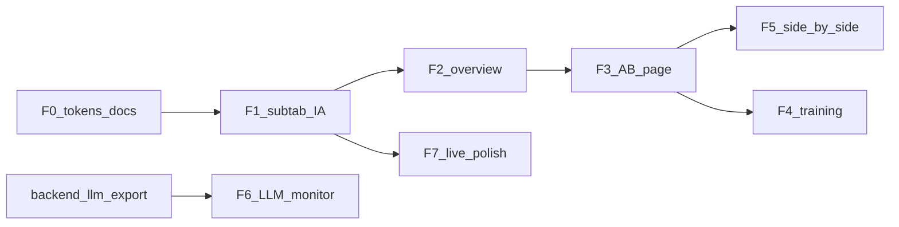

# KEMETRA frontend roadmap — Benchmark workspace

**Companion doc (repo):** [docs/FRONTEND_ROADMAP.md](docs/FRONTEND_ROADMAP.md)

**Related backend plan:** [backend_consolidation_roadmap_a5cb18ec.plan.md](backend_consolidation_roadmap_a5cb18ec.plan.md)

**Embed today:** [frontend/benchmark-view.jsx](frontend/benchmark-view.jsx) mounts into `#benchmarkView` from [frontend/app.js](frontend/app.js). Subnav lives in [frontend/index.html](frontend/index.html) (`data-benchmark-tab`).

---

## Design principles

- **KEMATRA look:** green accent + white glass ([frontend/styles.css](frontend/styles.css) `.benchmark-*`, [Panel](frontend/src/shared/ui/panel.tsx) on Astryx with [astryx-tokens.css](frontend/src/shared/theme/astryx-tokens.css) remapped to green—not purple/dark cotraffic).
- **English benchmark chrome:** Sidebar subtab **labels** under Benchmark are English (i18n can still translate page body elsewhere if needed).
- **Backend-backed:** Benchmark defaults to **live** data ([settings.dataSource](frontend/src/features/settings/store.ts) → `/api/data/*` via Vite proxy). Mock = bundled `public/data` for offline demos.
- **Not the main Overview:** The first subtab is a **benchmark study hub**, not a reuse of [OverviewPage.tsx](frontend/src/features/overview/OverviewPage.tsx) (that page stays for the full React app `/` route if used later).

---

## Benchmark information architecture (new subtabs)

Replace current French / generic mapping:

| Old `data-benchmark-tab` | Old label | New tab id | New sidebar label (English) | Page component | Backend / data |
| --- | --- | --- | --- | --- | --- |
| `overview` | Vue d'ensemble | `overview` | **Benchmark overview** | `BenchmarkOverviewPage` (new) | `meta`, `summary`, experiment defs |
| `agents` | Agents RL | `training` | **Training & hyperparameters** | `BenchmarkTrainingPage` (fork AgentsPage) | `meta.training`, `/api/data/training/*` |
| `compare` | Analyse comparative | `ab` | **A/B comparison** | `BenchmarkAbPage` (fork AnalyticsPage) | `comparisons`, `summary`; highlight `llm` |
| *(new)* | — | `side-by-side` | **Side-by-side** | `BenchmarkSideBySidePage` (new) | `POST /api/runs`, `meta.replays`, replay JSON |
| *(new)* | — | `llm` | **LLM monitor** | `BenchmarkLlmPage` (new) | `summary`/`raw` rows with `llm_*` metrics |
| `live` | Carte en direct | `live` | **Live map** | `LiveMapPage` (existing) | networks, replays; map HUD dark glass only |

**Suggested sidebar order:** Benchmark overview → A/B comparison → Side-by-side → Training & hyperparameters → LLM monitor → Live map.

Update [benchmark-view.jsx](frontend/benchmark-view.jsx) `PAGES` map and [app.js](frontend/app.js) `setBenchmarkTab` / active subnav styling together.

---

## Page specs (components for the new backend)

### 1. Benchmark overview (`BenchmarkOverviewPage`)

Purpose: **Detailed benchmarking landing** inside the Benchmark section—not the operator “dashboard overview.”

**Sections (all `Panel` + green KPI chips):**

- **Study status:** `meta.generatedAt`, `meta.runs`, methods list, networks; badge mock vs live.
- **Experiment coverage:** Cards for configured matrices—at minimum **core**, **llm_ab** ([configs/experiments/llm_ab.yaml](configs/experiments/llm_ab.yaml)), **sensitivity** ([configs/experiments/sensitivity.yaml](configs/experiments/sensitivity.yaml))—show cells/seeds/methods as read-only catalog (YAML parsed at build time or small JSON export from backend later).
- **Quick KPI matrix:** Same cell picker as overview but scoped copy: “Benchmark cells” + links to A/B and Side-by-side tabs.
- **Provenance:** Reuse [Provenance.tsx](frontend/src/features/overview/Provenance.tsx) patterns.
- **Next actions:** Links/buttons—“Compare LLM vs COOP”, “Launch side-by-side run” (disabled if not live).

### 2. A/B comparison (`BenchmarkAbPage`)

Purpose: **Statistical A/B** for RL vs LLM vs baselines (study-quality, not just pretty charts).

- Preset filters: **LLM A/B** (`mp`, `coop`, `llm` on grid2x2/grid3x3), **Core RQ1**, custom cell picker.
- Reuse [AnalyticsPage.tsx](frontend/src/features/analytics/AnalyticsPage.tsx) builders: forest, heatmap, paired deltas; default reference `mp`, controller `llm` when preset selected.
- Show **inference_ms_per_decision** when comparing LLM vs learned (already in [meta.metrics](frontend/public/data/meta.json)).
- Surface fairness note (UI copy): RL 5 s vs LLM 30 s decision interval—link to docs.

### 3. Training & hyperparameters (`BenchmarkTrainingPage`)

Purpose: **RL hyperparameter / variant exploration** (not generic “agents” page title).

- Learning curves from exported training JSON (existing [AgentsPage](frontend/src/features/agents/AgentsPage.tsx) logic).
- **Variant catalog table:** agents from `meta.training` + static descriptors for sensitivity variants (`coop_full_ev1`, `ind_queue`, `dqn`, etc.)—descriptions from [configs/agents/*.yaml](configs/agents/) (frontend JSON catalog or future `GET /api/agents` read-only).
- Checkpoint readiness: indicate if `llm` / learned methods have checkpoints (from meta or future policy API).

### 4. Side-by-side (`BenchmarkSideBySidePage`)

Purpose: **Interactive A/B in simulation**—two controllers, one episode, replay artifact.

- Embed [NewScenario.tsx](frontend/src/features/scenarios/NewScenario.tsx) + [Runs.tsx](frontend/src/features/scenarios/Runs.tsx).
- Replay gallery from `meta.replays` + [ReplayControls](frontend/src/features/replay/ReplayControls.tsx); default pairs e.g. `coop` vs `llm` when policy API allows.
- Requires **live** backend for launch; mock mode shows exported replays only + CTA to enable live.

### 5. LLM monitor (`BenchmarkLlmPage`)

Purpose: **Operational LLM benchmarking**—calls, latency, fallbacks, tokens.

**Data (backend dependency — document in ARCHITECTURE.md):**

- Evaluation rows for `method=llm` already expose controller metrics via [LLMController.metrics()](src/cotraffic/controllers/llm.py): `llm_calls`, `llm_success`, `llm_fallbacks`, `llm_latency_ms_mean`, token counts, etc.
- **Gap today:** [scripts/export_dashboard_data.py](scripts/export_dashboard_data.py) does not surface `llm_*` in dashboard JSON. Backend plan add-on: export `llm_runs.json` or extend `summary` rows + timeseries for LLM runs.
- **UI:** Table of LLM runs by cell/seed; line charts for latency and fallback rate; bar chart tokens per run; empty state with CLI hint (`cotraffic evaluate --experiment llm_ab`).

### 6. Live map (unchanged role, restyled shell)

- Keep [LiveMapPage](frontend/src/features/live-map/LiveMapPage.tsx) for spatial replay/network view.
- Light green glass **page chrome**; **dark glass only on map** (Events tab pattern).

---

## Phase F0 — Tokens and docs

Same as before: green Astryx overrides, [docs/DESIGN_TOKENS.md](docs/DESIGN_TOKENS.md), [docs/FRONTEND_ROADMAP.md](docs/FRONTEND_ROADMAP.md) including this IA table.

Remove / stop importing purple dark defaults inside benchmark mount (`data-theme="light"`, `data-astryx-theme="kemetra"`).

Delete dead [benchmark-rami.jsx](frontend/benchmark-rami.jsx) if still present.

---

## Phase F1 — Subtab registry and shell

- Implement `frontend/src/features/benchmark/` module:
  - `benchmarkTabs.ts` — id, label, icon, component
  - `BenchmarkLayout.tsx` — optional in-view tab bar mirroring sidebar (English), max-width shell matching `.benchmark-react-shell`
- Wire HTML subnav + `setBenchmarkTab` to new ids (`training`, `ab`, `side-by-side`, `llm`).
- Fix `Providers` nesting in [benchmark-view.jsx](frontend/benchmark-view.jsx) (single provider tree at mount root).

---

## Phase F2 — Build new pages (F2–F7 todos)

Implement pages in order of user value:

1. **Benchmark overview** (replaces OverviewPage in benchmark mount)
2. **A/B comparison** + **Side-by-side** (core A/B story)
3. **LLM monitor** (after backend export task)
4. **Training & hyperparameters**
5. **Live map** polish

Shared components to extract under `features/benchmark/components/`:

- `ExperimentCatalogCard` (yaml-driven)
- `AbPresetChips` (llm_ab, core, custom)
- `LlmRunTable`, `LlmMetricsCharts`
- `SideBySideLauncher` (wraps NewScenario)

All use **Panel**, **PageHeader**, **ChartCard**, green [methodColor](frontend/src/shared/domain/methods.ts) (add `llm` entry in green family).

---

## Phase F8 — Policy toggle UI

When backend exposes `GET/PUT /api/policy`: settings + Side-by-side defaults (RL vs LLM), status on Benchmark overview.

---

## Phase F9 — Single Vite entry (later)

Unchanged long-term goal; benchmark embed remains valid in `app.js` until parity.

---

## Cross-plan backend tasks (for LLM monitor + policy)

Add to **backend consolidation** plan (not implemented in frontend alone):

| Task | Owner | Unblocks |
| --- | --- | --- |
| Export `llm_*` metrics into dashboard JSON (`llm_runs.json` or summary fields) | export script + optional `/api/data/llm_runs` | LLM monitor tab |
| `GET/PUT /api/policy` | api/ | Side-by-side defaults, overview status |
| Optional `GET /api/experiments` — list experiment yaml metadata | api/ | Experiment catalog cards without rebuilding frontend |

---

## Success criteria

- Benchmark subtabs are **English-labeled**; **Benchmark overview** is a dedicated study hub (not “Vue d'ensemble”).
- A/B comparison, side-by-side runs, training/hyperparam views, and LLM plots exist as separate subtabs with **KEMATRA green/white glass**.
- Live backend drives launches and fresh results; mock mode degrades gracefully.
- No purple cotraffic skin in benchmark mount.

---

## Execution order

**Parallel:** F0–F2 can start without backend changes; **LLM monitor** waits on export/API for `llm_*` metrics.
