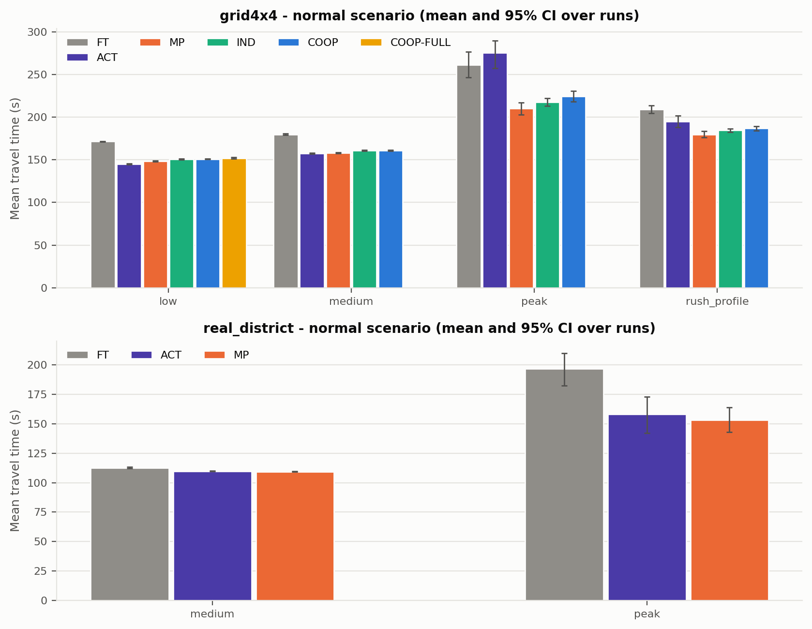

# CoTraffic - cooperative multi-agent traffic signal control

Final-year AI & Data Science project, *Intelligent Multi-Agent Traffic Management*.

Every signalised intersection is an autonomous reinforcement-learning agent. Agents
share one policy (PPO with parameter sharing), exchange short messages with their
neighbours, go through a safety shield that makes unsafe signal sequences impossible,
and are trained to reduce person-weighted waiting time while accounting for CO2,
emergency vehicles and pedestrians. They are compared with fixed-time (Webster),
actuated and Max-Pressure control, and with rule-based emergency-vehicle preemption, on a
synthetic grid and on a real district imported from OpenStreetMap, under normal, peak,
incident, emergency and failure conditions.

Simulation: [SUMO](https://eclipse.dev/sumo/) 1.27 through libsumo. CPU only.

## Dashboard

A control-room web application (React, TypeScript) presents the results: overview with
statistical comparisons, side-by-side replays on a map and in 3D, learning curves and
explained decisions, pedestrian and emergency-vehicle analyses, and an assistant that
answers questions from the result files. It runs without a backend on the exported
results (`cd frontend && npm install && npm run dev`); the optional FastAPI backend
(`uvicorn api.main:app`) adds the local language model and scenario runs. See
[frontend/README.md](frontend/README.md), [docs/API_CONTRACT.md](docs/API_CONTRACT.md)
and the demonstration guide [docs/DEMO_GUIDE.md](docs/DEMO_GUIDE.md).

## Install

Python 3.10 or newer. SUMO comes from pip, no system install is needed.

```bash
python -m venv .venv
# Windows: .venv\Scripts\activate    Linux/macOS: source .venv/bin/activate
pip install torch --index-url https://download.pytorch.org/whl/cpu   # CPU build, smaller
pip install -r requirements.txt
pip install -e . --no-deps
```

Check the installation (a few seconds):

```bash
python -m cotraffic smoke
python -m pytest -q
```

## Commands

The `Makefile` targets are aliases of the Python CLI, so everything also works on
Windows without `make`. `python -m cotraffic <command> --help` lists the options.

| make | python -m cotraffic ... | What it does |
|---|---|---|
| `make test` | (`python -m pytest -q`) | unit and integration tests |
| `make lint` | (`python -m ruff check src tests scripts dashboard`) | style |
| `make smoke` | `smoke` | quick end-to-end run of every feature (a few minutes) |
| `make networks` | `networks --all` | build the SUMO networks from `configs/networks` |
| | `calibrate-demand --net grid4x4 --scales ...` | demand calibration sweep (tuning seeds) |
| `make calibrate` | `calibrate --net grid4x4` | reward normalisation constants from baseline runs |
| `make train` | `train --agent coop --net grid4x4 --seed 1` | train one variant (resumes from its last checkpoint) |
| `make select` | `select` | choose the checkpoint of each run on validation seeds |
| | `validate --agents ind coop --baselines mp` | compare variants on validation seeds (design choices) |
| `make evaluate` | `evaluate --experiment full_matrix --jobs 2` | run an experiment matrix (skips runs already done) |
| | `evaluate --experiment sensitivity --jobs 2` | forecast agent, EV weight, preemption and pedestrian rules on Max-Pressure |
| `make aggregate` | `aggregate` | means, bootstrap CIs, Mann-Whitney U + Holm, Cliff's delta |
| `make figures` | `figures` | the report figures, PNG + SVG, in `figures/` |
| `make tables` | `tables` | `results/summary/REPORT_TABLES.md` |
| `make forecast` | `forecast --net grid4x4` | inflow forecasting dataset, models and scores |
| `make explain` | `explain --agent coop_full --net grid4x4` | decision log and feature-group importance |
| `make dashboard` | (`streamlit run dashboard/app.py`) | interactive results (no SUMO needed) |
| `make demo` | (`python scripts/demo_side_by_side.py`) | two sumo-gui windows, baseline vs COOP-FULL, plus a live chart: vehicles and pedestrians coloured by type, legend, `--follow-ev` (camera on each emergency vehicle), `--follow-incident` (accident, camera on the blocked street), `--snapshot-at` for screenshots; `--net real_district_ped`: the district with sidewalks and pedestrians (demonstration only, not evaluated) |
| | (`python scripts/open_in_sumo.py`) | one episode in sumo-gui on its own (fixed-time or actuated signals); `--3d` starts it in SUMO's 3D view (opening that view later from the 2D window crashes sumo-gui) |
| | `ask "Quel contrôleur est le meilleur à la pointe ?"` | question about the results, answered in French from the result files (local language model, below) |
| | `demo-plan "MP contre COOP-FULL à Tunis avec un accident" [--run]` | side-by-side demo described in plain words |
| | `llm-status` | is the local language model ready? |
| `make reproduce` | (`bash scripts/reproduce_all.sh`) | everything, from networks to tables |

`docs/RUN_PLAN.md` explains how to split training and evaluation between machines,
Kaggle (`notebooks/kaggle_train.ipynb`) and Colab (`notebooks/colab_train.ipynb`).

## Assistant (local language model)

The dashboard's *Assistant* tab and the `ask` / `demo-plan` commands accept requests in
plain French. A small model runs on the laptop through [Ollama](https://ollama.com) - free,
offline, no account:

```bash
# Windows: winget install --id Ollama.Ollama -e --source winget   (or the installer from ollama.com)
ollama pull qwen2.5:3b
python -m cotraffic llm-status
python -m cotraffic ask "Compare COOP et MP sur le quartier à la pointe" --table
python -m cotraffic demo-plan "MP contre COOP-FULL à Tunis avec un accident et des piétons" --run
```

Keywords read the request (the model reads only those they cannot classify, as JSON
restricted to values that exist in the results); code finds the answer in `results/summary/`
and the decision logs; the model phrases it, and a text with a number that is not in those
files is replaced by a sentence written by code. An answer takes 10-25 s on the laptop
(`--fast` skips the phrasing). Without Ollama everything still works (ADR-011).
`COTRAFFIC_LLM_MODEL` selects another model, e.g. `qwen2.5:7b` (better, slower).

## Repository layout

```
configs/        protocol.yaml (timing, episode protocol), networks/, demand/, scenarios/,
                agents/, experiments/, vehicles.yaml
src/cotraffic/  networks/ demand/ scenarios/ envs/ controllers/ training/ evaluation/
                analysis/ forecasting/ explainability/
sumo_files/     generated networks and route bundles (reproducible from configs)
results/        raw/ (one CSV per run), summary/, logs/, training/
figures/        report figures (PNG + SVG)
docs/           Design Thinking, decisions (ADR), FAILURES, EXPERIMENT_JOURNAL, PROGRESS,
                report/ (results, ablations and limitations sections)
tests/          pytest suite
```

## Reproducibility

- Every parameter lives in `configs/`; the code has no magic numbers.
- Demand, SUMO and learning are seeded. Test, validation and training seeds are disjoint,
  and `evaluate` / `select` refuse a seed outside their range (`src/cotraffic/seeds.py`).
- Every result row stores the method, network, scenario, demand, seed, checkpoint and git
  commit; interrupted training runs resume from their last checkpoint.
- Each traffic component (cars, buses, emergency vehicles, pedestrians) draws from its
  own random stream, so scenarios run with the same seed share the same car demand.

## Results

Full experiment matrix: 1 220 runs (core 790, extended 430) plus 70 sensitivity runs,
5 test seeds per cell, 3 training runs per learned variant (checkpoints chosen on
validation seeds). Write-up per research question:
`docs/report/08_results.md` (ablations and limitations in sections 9 and 10); every table,
with 95% confidence intervals and tests: `results/summary/REPORT_TABLES.md`.

Mean travel time (s), normal traffic (lower is better; best in bold):

| Network, demand | FT | ACT | MP | IND | COOP |
|---|---|---|---|---|---|
| grid4x4, low | 171.4 | **145.0** | 148.5 | 150.8 | 150.8 |
| grid4x4, medium | 179.8 | **157.3** | 157.9 | 161.1 | 161.0 |
| grid4x4, peak | 261.2 | 275.3 | **210.2** | 217.5 | 224.6 |
| grid4x4, rush profile | 209.2 | 195.0 | **179.9** | 184.5 | 186.7 |
| district, medium | 112.7 | 109.9 | **109.4** | 109.7 | 109.9 |
| district, peak | 196.8 | 158.3 | **153.4** | 158.4 | 159.5 |
| grid8x8, peak (trained on grid4x4) | 365.5 | - | **300.7** | 312.7 | 313.1 |

- On these networks Max-Pressure plus simple rules remains the best controller:
  Max-Pressure is best in 4 of 6 cells and within 2.4% of the best in all. The learned
  agents are 0.2-4% (IND) and 0.4-7% (COOP) slower than the best controller of each cell,
  never faster, so they are not better generalists than Max-Pressure.
- The learned agents clearly beat fixed-time control (10-20%, 3% at district medium) and
  actuated control where it breaks down (-21% at grid peak); actuated control stays 2-4%
  better at low and medium demand.
- Emergency vehicles: a preemption rule on top of Max-Pressure cuts their delay by 64% for
  +0.4% of travel time; the learned COOP-FULL cuts it by 37% compared with COOP, at no
  cost to the other traffic, but less than the rule.
- CO2 follows travel time on our networks: there is no trade-off between the two.
- Under sensor faults the learned IND agent loses 1.4% of travel time, Max-Pressure 21.5%
  (partly because our safety shield cannot see a movement whose detectors failed).
- The policy trained on 16 junctions runs unchanged on 64, at 4% from Max-Pressure.
- Pedestrians: COOP-FULL lowers the mean pedestrian wait by 24% compared with a
  pedestrian rule on Max-Pressure, at +2.6% of vehicle travel time; the rule caps the
  longest waits at no vehicle cost.
- What did not work: messages between neighbouring agents (F-009), reward redesign
  (F-007) and a forecast of arrivals in the observation did not close the gap; the
  learned agents handle accidents worse than Max-Pressure on the grid, and COOP-FULL
  gridlocks in 4 of 15 runs at peak with pedestrians (`docs/FAILURES.md`, F-014).
- Contribution: a fair, reproducible benchmark (same shield, seeds, statistics and base
  controllers for every method) and the diagnosis of why learning does not beat
  Max-Pressure here (F-007, F-009, F-013).


