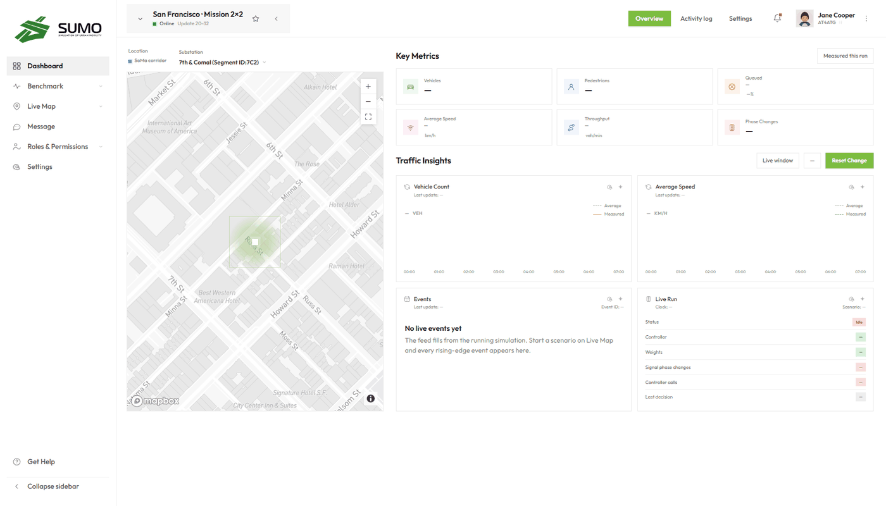
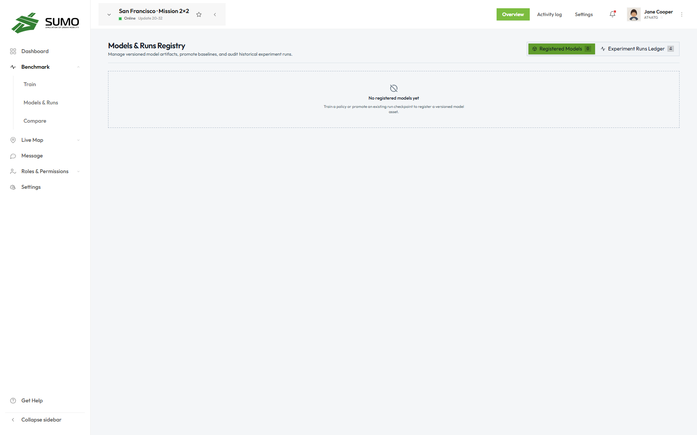
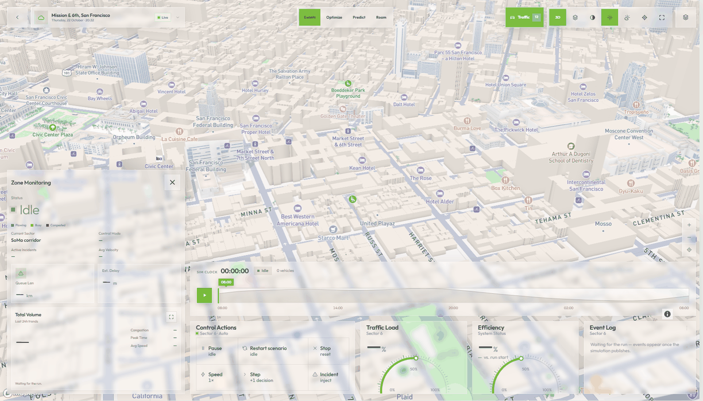

# Intelligent Multi-Agent Urban Traffic Management

> **Course:** Advanced Data Science Project - Esprit School of Engineering (5DS8)  
> **Supervisor:** Islem Maiti  
> **Team:** Hazem Mrad, Bilel Brini, Lina Haddad, Amen Allah Ben Aissa, Rami Ben Slimen

---

## 🎯 Project Overview

This project explores how **intelligent autonomous agents** and **data science** can be combined to build a smarter, more adaptive urban traffic management system.

We use [Eclipse SUMO](https://sumo.dlr.de) as the microscopic traffic simulator and implement a **Multi-Agent Reinforcement Learning (MARL)** framework where each intersection is controlled by an independent agent that learns to minimize congestion, support pedestrian safety, and coordinate emergency vehicle priority.

**Challenge Question:**  
> *"How might we use data and intelligent agents to make urban traffic more efficient, adaptive, and sustainable?"*

---

## 🗺️ Roadmap

| Phase | Scenario | Status |
|-------|----------|--------|
| Phase 1 | 2x2 grid - toy validation | ✅ Done |
| Phase 2 | 3x3 grid - main benchmark | 🟡 Generalist PPO trained to 502k steps (seed 1); benchmark comparison pending |
| Phase 3 | Monaco - real-world network | 🟡 Network + demand routes built; benchmark runs pending |
| Phase 4 | Tunis - real-world network | 🟡 Network, routes and fixed-time demand sweep recorded; learned-controller runs pending |

### Networks and demand

| Network | Source | Notes |
|---------|--------|-------|
| `grid2x2` | generated grid | toy validation, 2x2 signalised intersections |
| `grid3x3` | generated grid | main benchmark network |
| `monaco` | [MoSTScenario](https://github.com/lcodeca/MoSTScenario) (Codeca & Härri, SUMO User Conference 2018) | whole principality, 3,523 junctions, 18,837 edges, 12 signalised intersections, pedestrian areas, bus and train stops |
| `tunis` | OpenStreetMap via Overpass API + `netconvert` | central Tunis, roughly 5.2 km x 4.3 km, lake edge and port to El Menzah, real signalised junctions |

Demand is generated per network from `configs/demand/*.yaml` (`low`, `medium`, `peak`) crossed with `configs/scenarios/*.yaml` (incident, pedestrians, buses, emergency pre-emption, communication dropout, sensor noise), and each run is written to `results/`.

Generated artifacts are **gitignored**, so the networks, routes and runs are not in the repository and have to be rebuilt locally:

```bash
python -m cotraffic networks tunis --force      # OSM import -> sumo_files/tunis/tunis.net.xml (~24 MB)
python -m cotraffic networks monaco --force     # MoSTScenario -> sumo_files/monaco/monaco.net.xml (~14 MB)
```

---

## 📁 Repository Structure

```
intelligent-marl-traffic/
├── src/cotraffic/       # Backend domain: env, controllers, training, evaluation, CLI
├── api/                 # FastAPI layer: data, runs, assistant, policy, live simulation
├── configs/             # protocol, networks, agents, scenarios, experiments (all parameters)
├── tests/               # pytest: API contract + domain checks
├── scripts/             # export/replay/reproduce entry points, explore/ research helpers
├── frontend/            # Single frontend (Vite)
│   ├── index.html       #   entry -> src/shell/app.js (control-room shell)
│   ├── styles.css       #   KEMETRA green/white tokens and layout
│   └── src/
│       ├── app/         #   React shell: router, nav, providers, theme
│       ├── features/    #   one folder per page (overview, live-map, agents, ...)
│       ├── shared/      #   api client, schemas, ui, charts, i18n, theme tokens
│       └── shell/       #   vanilla shell, Mapbox/3D env, benchmark island mount
├── docs/                # ARCHITECTURE, DESIGN_TOKENS, FRONTEND_ROADMAP, plans/
├── sumo_files/          # generated SUMO networks (gitignored)
└── results/             # generated runs, summary, checkpoints (gitignored)
```

One backend (`src/cotraffic` + `api/`), one frontend (`frontend/`). The retired stacks
(`environment/`, `baselines/`, `evaluation/`, `agents/`, the Streamlit dashboard, the grid
scenario runners) are documented in [docs/ARCHITECTURE.md](docs/ARCHITECTURE.md) §8.

---

## 🚀 Quick Start

### Prerequisites
- [Eclipse SUMO](https://sumo.dlr.de/docs/Installing/index.html) ≥ 1.20
- Python ≥ 3.10
- WSL Ubuntu (optional, for Linux-native SUMO)

### Setup
```bash
git clone https://github.com/Esprit-School-of-Engineering-5DS8/intelligent-marl-traffic.git
cd intelligent-marl-traffic
pip install -r requirements.txt       # runtime
pip install -r requirements-dev.txt   # tests and linting (optional)
cd frontend && npm install
```

### Run a scenario (cotraffic CLI)
```bash
python -m cotraffic networks --net grid2x2           # build the SUMO network
python -m cotraffic episode --net grid2x2 --demand medium --seconds 600
python -m cotraffic evaluate --experiment llm_ab_quick --jobs 1
python -m cotraffic evaluate --experiment llm_vs_rl --jobs 2   # LLM team vs trained RL arm
python -m cotraffic aggregate && python -m cotraffic tables
```

### Dashboard (live simulation + results)
```bash
uvicorn api.main:app --port 8000                     # backend
cd frontend && npm install && npm run dev            # Vite on :5173
python scripts/export_dashboard_data.py              # refresh served result files
```

### Switch and train models from the dashboard

**Settings → Models** owns the model *choice*, and every action there is an ordinary API
call. Training happens in the **Train** tab, never in Settings:

| Panel | What it does | Endpoint |
|---|---|---|
| Controller per scenario | one row per network (2x2, 3x3, Monaco, Tunis): runs a baseline, a trained recipe, `llm` or `llm_team` for **that** network | `PUT /api/policy` |
| Trained weights | pins one checkpoint (selected run, raw training run, saved version) for the chosen network | `PUT /api/policy` with `checkpoint` |
| LLM provider | `openrouter` (Gemma 4), `groq`, `gemini` or `opencode`, plus the model id | `PUT /api/llm/config` |

The controller is stored **per network**, because a policy trained on one grid cannot
drive another: `GET /api/policy` returns `perNetwork` (each scenario's controller,
weights and readiness) next to the last-edited `method`/`network`. `scenario` configs
(`emergency`, `buses`, `pedestrians`, `incident`) are event mixes *inside* every
training episode, not separate networks — one `generalist` policy already covers them,
and training them separately only means a recipe variant with a smaller
`training.scenarios` list.

The same steps from a shell:

```bash
# 1. Run the stack
uvicorn api.main:app --port 8000                     # backend on :8000
cd frontend && npm run dev                           # dashboard on :5173

# 2. Point the LLM and LLM-team controllers at Gemma 4 through OpenRouter
#    (OPENROUTER_API_KEY must be set; Settings → Integrations writes it to .env)
curl -X PUT http://localhost:8000/api/llm/config \
  -H 'Content-Type: application/json' \
  -d '{"provider":"openrouter","model":"google/gemma-4-26b-a4b-it:free"}'

# 3. Give each scenario its own controller (baseline, trained recipe, llm or llm_team)
curl -X PUT http://localhost:8000/api/policy \
  -H 'Content-Type: application/json' \
  -d '{"method":"llm_team","network":"sf_mission_3x3"}'
curl -X PUT http://localhost:8000/api/policy \
  -H 'Content-Type: application/json' \
  -d '{"method":"mp","network":"monaco"}'
curl http://localhost:8000/api/policy                              # perNetwork[] per scenario

# 4. Train, then save and pin the finished weights
curl -X POST http://localhost:8000/api/train \
  -H 'Content-Type: application/json' \
  -d '{"recipe_id":"generalist","network":"sf_mission_3x3","seeds":[1],"timesteps":50000}'
curl http://localhost:8000/api/jobs                              # progress
curl http://localhost:8000/api/models/candidates                 # candidate ids
curl -X POST http://localhost:8000/api/models/register-candidate \
  -H 'Content-Type: application/json' \
  -d '{"candidate_id":"generalist|sf_mission_3x3|1","name":"sf-mission-3x3-ppo"}'
curl -X PUT http://localhost:8000/api/policy \
  -H 'Content-Type: application/json' \
  -d '{"method":"generalist","network":"sf_mission_3x3","checkpoint":"results/models/<id>/weights.zip"}'
```

Without `OPENROUTER_API_KEY` the LLM methods still run: every call falls back to
Max-Pressure and `GET /api/policy` reports the degradation in `reason`.

### Screenshots

| Dashboard | Benchmark - Models & Runs |
|---|---|
|  |  |



Captured from `npm run dev` with the API on `:8000`. The live map and the dashboard's
street panel are drawn with a public Mapbox `pk.` token read from the browser's
`localStorage`, so no token is committed with the screenshots. The live-map shot was taken during a running `grid-2x2` simulation
(`POST /api/simulation/start`, 4x speed) with vehicles and pedestrians on the network;
the dashboard shows the same basemap while its live panels are still waiting for the
run's feed. The registry row is a real `generalist`
checkpoint (`sf_mission_3x3`, PPO, seed 1); the 500k-step training run and its
validation-based checkpoint selection are separate, long-lived steps.

### Controller methods
| `method` | Description |
|------|-------------|
| `ft` | Fixed-time Webster plan (baseline) |
| `act` | Actuated gap-out / max-out |
| `mp` | Max-Pressure adaptive heuristic |
| `ev_rule`, `ev_rule_mp` | Emergency pre-emption |
| `ped_rule_mp` | Pedestrian-aware MP |
| `ind`, `coop`, `coop_full`, `coop_eco*` | PPO learned variants (checkpoint required) |
| `dqn` | DQN comparison agent |
| `llm` | Batched language-model controller, MP fallback |
| `llm_team` | Three-role LLM team (Operator, Emergency, Pedestrian) over Max-Pressure; typed directives are validated, arbitrated and then passed through the safety shield |

`generalist` is the flagship learned policy (all demand levels and event scenarios, one
checkpoint per training seed). `configs/experiments/llm_vs_rl.yaml` runs it head-to-head
against `llm_team` on the same seeds; set `COTRAFFIC_LLM_BACKEND=mock` to run the LLM arm
without spending tokens, and train + select a `generalist` checkpoint first.

Full architecture, controller catalog and A/B protocol: [docs/ARCHITECTURE.md](docs/ARCHITECTURE.md).

---

## 👥 Team & Responsibilities

| Member | Role | Objectives |
|--------|------|------------|
| Hazem Mrad | Simulation & Environment Lead | F1, F2 - SUMO scenarios, data pipeline, baselines |
| Bilel Brini | RL Agent Developer | F3, M1, M3 - DQN/PPO, multi-agent, emissions |
| Lina Haddad | Pedestrian & Safety Module | S1, S2, S3 - pedestrian-adaptive signals, safety |
| Amen Allah Ben Aissa | Emergency Priority | E1, E2 - green corridor, EV detection & ETA |
| Rami Ben Slimen | Evaluation & Forecasting | F4, F5, M2 - experiments, visualization, reporting |

---

## 📊 Key Metrics Tracked

Every run writes one row per evaluation, per method and demand scale:

| Column | Meaning |
|--------|---------|
| `vehicles`, `arrived_vehicles` | demand loaded and throughput (vehicles reaching destination) |
| `mean_travel_time`, `mean_waiting_time`, `mean_time_loss` | network-level delay |
| `p95_waiting_time` | tail of the waiting-time distribution |
| `mean_queue`, `mean_insertion_backlog` | queue pressure at junctions and demand that could not enter the network |
| `throughput_per_h` | arrived vehicles per hour |
| `unfinished`, `never_inserted`, `teleports_total` | runs that did not complete cleanly |
| `co2_mg_s`, `fuel_ml_s` | emissions and consumption |

---

## 🎨 Design Thinking Process

This project follows the **Design Thinking** methodology:

| Phase | Status | Deliverable |
|-------|--------|-------------|
| Empathize | ✅ Done | Personas: Mehdi (driver), Sarra (pedestrian), Sonia (EV responder), Karim (operator) |
| Define | ✅ Done | Problem statement, POV statements, HMW questions, success criteria |
| Ideate | 🟡 In Progress | Approach shortlist, chosen direction |
| Prototype | ✅ Done | Working SUMO + MARL prototype across grid, Monaco and Tunis networks |
| Test | 🟡 In Progress | Fixed-time demand sweep on Tunis recorded; benchmark vs baselines pending |

---

## 📜 License

MIT License - see [LICENSE](LICENSE)

