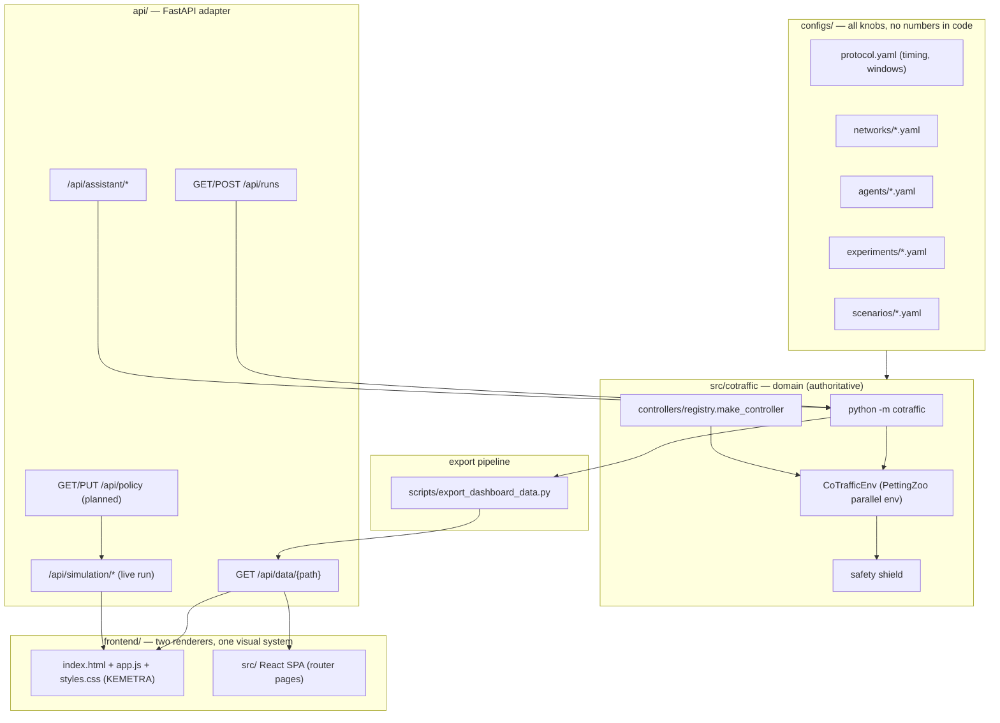

# KEMETRA Architecture

> Single source of truth for how simulation, evaluation, the HTTP API and the dashboard fit
> together. Read this before adding a controller, an endpoint or a screen.
>
> Status: Phase 0 (documentation). Sections marked **planned** describe the target state of
> the roadmap; everything else describes code that exists today.

---

## 1. Purpose and ownership

The repository holds a **research study** (MARL traffic control on SUMO) and a
**control-room demo** (the KEMETRA dashboard) that presents it. They must not drift apart:
the numbers on the dashboard are the numbers the study produced.

| Concern | Owner | Notes |
|---|---|---|
| Simulation, controllers, metrics, training | `src/cotraffic/` | The only place that moves vehicles or picks signal phases |
| Batch experiments and statistics | `src/cotraffic/` CLI (`python -m cotraffic`) | Writes `results/raw`, `results/summary` |
| HTTP adapter for the dashboard | `api/` | Thin: no TraCI logic of its own (target state) |
| Result files served to the UI | `frontend/public/data/*.json` | Produced by `scripts/export_dashboard_data.py` |
| Dashboard (control room) | `frontend/index.html` + `app.js` + `styles.css` | Vanilla Vite app, KEMETRA green/white glass |
| React SPA pages | `frontend/src/` | Overview/Agents/Live/Analytics/etc.; entry currently not wired (`main.tsx` exists but `index.html` loads `app.js`) |
| Benchmark tab today | `frontend/benchmark-rami.jsx` | Mounts four React pages inside the vanilla shell; to be removed once the React entry owns them |

**Rule:** anything that influences traffic for a reported number, a replay, or the live
demo goes through `make_controller` + `CoTrafficEnv` + the safety shield. Nothing bypasses
them.

---

## 2. Layers



Two data sources, one contract:

- **mock**: static JSON in `frontend/public/data/<path>.json`, no backend needed;
- **live**: the same files served by FastAPI at `/api/data/<path>`.

The dashboard switches with the `dataSource` setting; both show identical numbers because
they are the same files.

---

## 3. Controller catalog

`method` strings are the only identifiers used in configs, results and the API. UI labels
are presentation only.

| UI label | `method` | Checkpoint required | Notes |
|---|---|---|---|
| Fixed-time | `ft` | no | Webster plans from the calibration seed |
| Actuated | `act` | no | gap-out / max-out |
| Max-Pressure | `mp` | no | Varaiya-style pressure rule |
| EV rule | `ev_rule` | no | pre-emption inside `ev_preemption_range_m` |
| EV rule + MP | `ev_rule_mp` | no | pre-emption, MP otherwise |
| Pedestrian rule | `ped_rule_mp` | no | serves a crossing after `ped_rule_wait_s` |
| Independent PPO | `ind` | `results/checkpoints/ind/<net>/seed1.zip` | no neighbour messages |
| Cooperative PPO | `coop` | `results/checkpoints/coop/<net>/seed1.zip` | neighbour summaries |
| COOP + forecast | `coop_forecast` | `…/coop_forecast/…` | adds Ridge inflow forecast |
| COOP eco | `coop_eco`, `coop_eco05` | `…/coop_eco*/…` | CO₂ term at λ=1.0 / 0.5 |
| COOP full | `coop_full` | `…/coop_full/…` | all observation blocks |
| DQN | `dqn` | `…/dqn/…` | comparison agent |
| LLM | `llm` | no | batched language model, `mp` fallback |

Checkpoints resolve through `cotraffic.paths.default_checkpoint(agent, network)` — training
run 1 of that agent/network (`seed1.zip`). Learned methods without a checkpoint must be
rejected by the API (`422`), never silently downgraded.

LLM environment (`configs/agents/llm.yaml`, overridable by `COTRAFFIC_LLM_*`):

| Variable | Meaning |
|---|---|
| `COTRAFFIC_LLM_PROVIDER` | `groq` (default) or `gemini` |
| `GROQ_API_KEY` / `GEMINI_API_KEY` | key, stays server-side (`.env`, never in the browser) |
| `COTRAFFIC_LLM_MODEL` | model id (default `openai/gpt-oss-20b` on Groq) |
| `COTRAFFIC_LLM_INTERVAL_S` | seconds of sim time between calls (default 30) |
| `COTRAFFIC_LLM_MAX_CALLS` | hard cap per episode; **0 means unlimited** |
| `COTRAFFIC_LLM_TIMEOUT`, `…_ATTEMPTS` | request timeout and retries |
| `COTRAFFIC_LLM_MIN_WALL_INTERVAL_S` | wall-clock pacing to protect the quota |
| `COTRAFFIC_LLM_LOG` | `1` prints one line per call (`1` in CI/diagnostics) |

The LLM controller only *proposes* phase changes; every decision still passes the shield,
and an unavailable/invalid answer falls back to Max-Pressure (`fallback: mp`).

---

## 4. HTTP API (as of Phase 0)

| Method | Path | Purpose |
|---|---|---|
| GET | `/api/health` | liveness, data presence, active runs |
| GET | `/api/data/{path}` | one exported result file (`frontend/public/data/<path>.json`) |
| GET | `/api/assistant/status` | assistant backend availability |
| POST | `/api/assistant/chat` | SSE answer; numbers come from result files |
| GET/POST | `/api/runs` | launch a side-by-side replay (`scripts/record_replay.py`) |
| GET | `/api/simulation/state` | live run snapshot (`simulationTime`, `vehicles`, `status`, …) |
| GET | `/api/simulation/network/{scenario}` | GeoJSON of the grid network |
| POST | `/api/simulation/start` \| `pause` \| `resume` \| `stop` \| `step` \| `speed` | live-run controls |
| WS | `/ws/simulation` | snapshot stream for the 3D view |
| WS | `/ws/status` | run-queue badge |
| GET/PUT | `/api/policy` | active control policy (method + checkpoint + availability) |

Routers live in `api/routes/`; `api/main.py` only assembles the app and CORS.

---

## 5. Runbooks

### 5.1 Study pipeline (batch, authoritative)

```bash
# 1. networks (only when a config changed)
python -m cotraffic networks --net grid4x4

# 2. train one variant, one network, one seed
python -m cotraffic train --agent coop --net grid4x4 --seed 0

# 3. pick the best checkpoint on validation seeds (never evaluation seeds)
python -m cotraffic select --agent coop --net grid4x4 --seed 0

# 4. evaluate an experiment matrix
python -m cotraffic evaluate --experiment llm_ab --jobs 2

# 5. aggregate + report tables
python -m cotraffic aggregate
python -m cotraffic tables        # results/summary/REPORT_TABLES.md

# 6. refresh the files the dashboard reads
python scripts/export_dashboard_data.py
```

`evaluate` is resumable: existing `results/raw/<run_id>.csv` files are skipped unless
`--force` is passed. Use `--methods` to rerun a subset.

### 5.2 Live demo

```bash
uvicorn api.main:app --port 8000          # from the repository root
cd frontend && npm run dev                # Vite on :5173, proxies /api and /ws to :8000
```

Select the controller in Settings (or `PUT /api/policy`), then start a run from the live
map. The run uses the same controllers, shield and configs as the batch pipeline.

### 5.3 Smoke checks

```bash
python -m cotraffic smoke            # end-to-end check of every feature
python -m cotraffic evaluate --experiment llm_ab_quick   # short A/B matrix
python -m pytest tests -q
```

---

## 6. A/B protocol (RL vs LLM vs Max-Pressure)

Config: `configs/experiments/llm_ab.yaml` — `mp`, `coop`, `llm` on `grid2x2` and `grid3x3`,
demands `medium` and `peak`, seeds `[0, 1, 2]`. Cells share evaluation seeds so the same
demand realisation is seen by every method (paired comparison).

Fairness constraints to state whenever these numbers are reported:

1. **Decision cadence differs by design.** RL agents decide every
   `protocol.timing.delta_time = 5 s`; the LLM is called every
   `call_interval_s = 30 s` (cost and latency). Continuous-time KPIs therefore compare
   controllers with different reaction speeds — this is a property of the method, but it
   must be named.
2. **Fallbacks count.** Invalid, missing or unavailable LLM answers fall back to
   Max-Pressure. An episode with many fallbacks is closer to MP than to "LLM", so call
   success rate is part of the result, not an implementation detail.
3. **Call caps.** `max_calls: 0` means unlimited, but the environment variable
   `COTRAFFIC_LLM_MAX_CALLS` overrides it. A cap (for example 40) means the LLM steers only
   the first 20 minutes of sim time and MP steers the rest — the treatment is diluted. Log
   the effective cap next to the results.
4. **Rate limits are data.** Groq returns `429` when the daily/per-minute token budget is
   spent; the controller falls back to MP. Check `results/logs` for `429` lines before
   quoting a cell. Two parallel workers (`--jobs 2`) double the call rate against the same
   key — for LLM cells prefer `--jobs 1`.
5. **Statistics.** Comparisons are Mann-Whitney U with Holm correction and Cliff's delta;
   learned methods bootstrap over both training runs and test seeds.

---

## 7. Frontend and visual system

- **Design tokens (vanilla):** `frontend/styles.css` `:root` — `--ink`, `--muted`,
  `--line`, `--green: #7cbd40`, `--green-deep: #5f9c2b`, white surfaces, glass panels,
  Outfit font. This is the KEMETRA visual language.
- **Design tokens (React):** `frontend/src/shared/theme/index.css` (KEMETRA palette mapped
  onto Tailwind) and `frontend/src/shared/theme/astryx-tokens.css`
  (`@astryxdesign/core` CSS variables, 0-radius). The purple `#5b4bd6` / `#9a8cff` accents
  are gone; `astryx-tokens.css` still carries a dark base palette, which the live map wants
  but the cards do not. Full mapping: [DESIGN_TOKENS.md](DESIGN_TOKENS.md).
- **Frontend roadmap:** [FRONTEND_ROADMAP.md](FRONTEND_ROADMAP.md) — benchmark shell,
  subtab pass, policy settings, single Vite entry.
- **Current entries:** `frontend/index.html` loads `app.js` (vanilla control room). The
  benchmark tab renders `frontend/benchmark-view.jsx`: one React page at a time, chosen by
  the sidebar (`[data-benchmark-tab]`), with no duplicate tab bar. **Next:** switch the
  entry to `src/main.tsx` once the live map reaches parity, then `app.js` retires.
- **Persisted settings:** key `cotraffic-settings` (localStorage). Keep the name when adding
  fields so user preferences survive migrations; bump `version` in the store.

---

## 8. Deprecation map

| Path | Status | Replaced by |
|---|---|---|
| `environment/multi_agent_env.py` | **removed** | `src/cotraffic/envs/traffic_env.py` |
| `baselines/*.py` | **removed** | `src/cotraffic/controllers/classical.py` and friends |
| `evaluation/benchmark_baselines.py`, `evaluation/run_experiments.py` | **removed** | `python -m cotraffic evaluate` |
| `agents/` (incl. `agents/rl/*` stubs) | **removed** | `src/cotraffic/training/train.py` (SB3 PPO) |
| `scenarios/*/runner.py` | **removed** | `python -m cotraffic episode` |
| `examples/marl_quickstart.py` | **removed** | `python -m cotraffic episode` |
| `frontend/benchmark-rami.jsx` | **removed** | `frontend/benchmark-view.jsx` (sidebar-driven React pages) |
| `api/simulation.py` (raw TraCI + SUMO programs) | **replaced** | `CoTrafficEnv` + `make_controller` + `/api/policy` |

Retired-module tests (`test_baselines`, `test_marl_env`, `test_monaco`, `test_multimodal`)
were replaced by `tests/test_policy_api.py`, which covers the contract the dashboard uses.

Deletion is gated by `docs/MIGRATION_CHECKLIST.md`. Keep SUMO scenario assets
(`scenarios/grid_2x2`, `scenarios/grid_3x3`) until networks are generated purely from
`configs/networks/`.

---

## 9. Environment variables

| Variable | Where | Purpose |
|---|---|---|
| `SUMO_HOME`, `LIBSUMO_AS_TRACI` | shell/`.env` | SUMO binaries and the fast TraCI binding |
| `COTRAFFIC_ROOT` | shell | repository root override (Kaggle/Colab) |
| `GROQ_API_KEY`, `GEMINI_API_KEY` | `.env` (server) | LLM providers; never sent to the browser |
| `COTRAFFIC_LLM_*` | `.env` | provider/model/interval/limits (see §3) |
| `FRONTEND_ORIGIN` | `.env` | CORS origin for the Vite dev server |
| `VITE_MAPBOX_TOKEN` | `frontend/.env` | 3D map |

`.env` is gitignored; `.env.example` documents every key with a placeholder.

---

## 10. Known caveats

- The live simulation (`/api/simulation`) still starts raw SUMO programs until Phase 1
  rewrites it on `CoTrafficEnv`; its numbers are not comparable to the study's.
- `python -m cotraffic aggregate` needs `scipy`; an Application Control policy on some
  Windows machines blocks one DLL intermittently — rerun, or use a Python where
  `import scipy.stats` succeeds.
- `results/` is gitignored: experiments are reproducible from configs and seeds, not from
  committed files.
