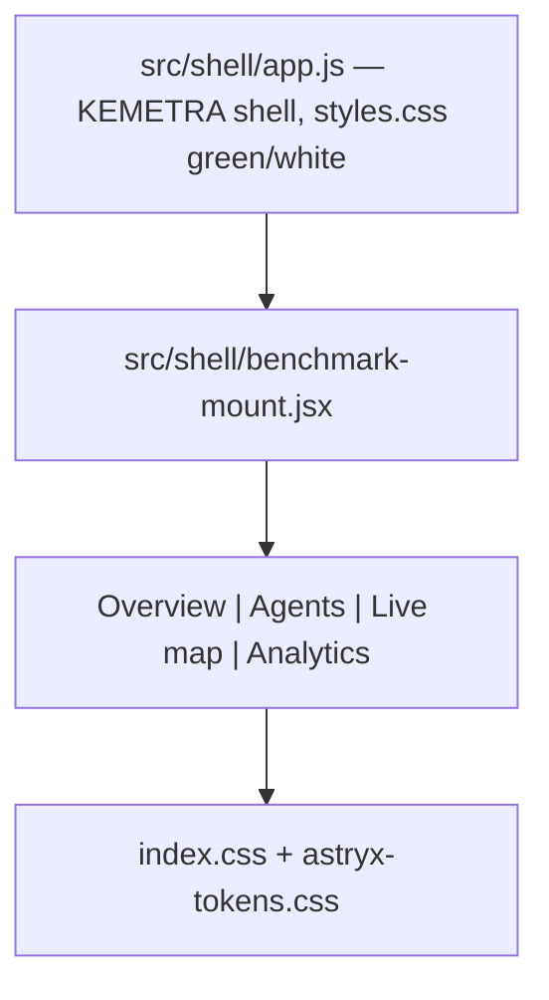
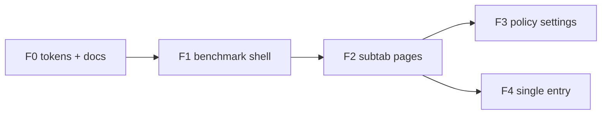

# KEMETRA frontend roadmap — Benchmark and dashboard UI

> Companion to [ARCHITECTURE.md](ARCHITECTURE.md) §7 (frontend and visual system) and
> [MIGRATION_CHECKLIST.md](MIGRATION_CHECKLIST.md) §3 (frontend contract).
> Token reference: [DESIGN_TOKENS.md](DESIGN_TOKENS.md).
>
> The backend is no longer part of this plan: `src/cotraffic` + `api/` are the single
> source of truth and the React pages consume `/api/data/*`, `/api/runs`, `/api/policy`.

## Why this is a separate plan

| Backend (done)                                      | Frontend (this plan)                                      |
| --------------------------------------------------- | --------------------------------------------------------- |
| `src/cotraffic`, `api/`, experiments, RL/LLM policy  | `frontend/`, design tokens, benchmark shell, React pages   |
| Python tests, migration checklist                   | Visual parity, Vite proxy, TanStack Query                  |
| When the sim runs and which controller              | How results look and which data source is active           |

The two meet only at the contracts: `GET /api/data/*`, `GET /api/health`,
`GET/POST /api/runs`, `GET/PUT /api/policy`, and the `dataSource` setting.

## The UI problem

The dashboard is a KEMETRA green/white vanilla shell (`frontend/styles.css`) that embeds a
React island, so the benchmark area used to open a second visual system — purple accent,
dark `bg-bg` — inside the light control room.

Files at the centre of it:

- Embed: [frontend/src/shell/benchmark-mount.jsx](../frontend/src/shell/benchmark-mount.jsx)
  (replaced `benchmark-rami.jsx`, which mounted its own duplicate tab bar)
- Host nav: [frontend/src/shell/app.js](../frontend/src/shell/app.js) — `#benchmarkView`,
  sidebar `data-benchmark-tab`
- Reference styling: [frontend/styles.css](../frontend/styles.css) — `.benchmark-*`, `--green`
- React tokens: [index.css](../frontend/src/shared/theme/index.css),
  [astryx-tokens.css](../frontend/src/shared/theme/astryx-tokens.css)
- Shared components: [panel.tsx](../frontend/src/shared/ui/panel.tsx),
  [OverviewPage.tsx](../frontend/src/features/overview/OverviewPage.tsx)

## Design target

- **Accent:** green — `#7cbd40` (styles.css `--green`), `#5f9c2b` deep / text-safe
- **Surfaces:** white and light glass — `rgba(255,255,255,.85–.9)`, border `#d3dbe3`
- **Radius:** 0 everywhere (the Astryx 0-radius system already shipped)
- **Typography:** Outfit (shell), IBM Plex Sans (charts)
- **Astryx:** keep `@astryxdesign/core` through `Panel` / `KButton`; override its tokens to
  the KEMETRA light palette instead of the dark purple one
- **Exception:** the live-map subtab keeps dark glass **on the map canvas only**; its cards
  stay light

## Phases

### F0 — Documents and token base (done / current)

- [x] `docs/FRONTEND_ROADMAP.md` (this file) and `docs/DESIGN_TOKENS.md`
- [x] `index.css` `--accent` / `--focus` / `--accent-soft` are green, not purple
- [x] `charts/tokens.ts` accent fallback green; `methods.ts` LLM colour `#7cbd40`
- [x] Benchmark mount carries `data-theme="light"` + `data-astryx-theme="kemetra"`, so the
      benchmark stays light even when the stored dashboard theme is dark
- [x] `astryx-tokens.css` declares the light KEMETRA palette by default; dark applies only
      under `[data-theme="dark"]`
- [x] `.benchmark-view` (the vanilla host element) is painted light explicitly — it used
      `var(--bg)`, which follows the `<html>` theme and turned the page navy
- [x] Default settings theme is `light`; the live map keeps its dark canvas by forcing
      `theme="dark"` on `NetworkMap` while its cards stay light

Do **not** rename the `cotraffic-settings` localStorage key: it would wipe user prefs.

### F1 — Benchmark shell

- [x] Single embed (`src/shell/benchmark-mount.jsx`) with `Providers` (QueryClient, i18n,
      settings)
- [x] No duplicate tab bar: the shell sidebar owns subtab selection
- [x] `benchmark-rami.jsx` / `benchmark-live.jsx` removed
- [ ] Promote to `frontend/src/features/benchmark/BenchmarkShell.tsx` with a
      `mountBenchmark(container)` export so `app.js` imports one module instead of JSX glue
- [ ] Subtab labels/sync through one shared source (currently `app.js` `data-benchmark-tab`)

### F2 — Subtab pass

| Subtab     | Page             | Live backend                                    | UI work                                  |
| ---------- | ---------------- | ----------------------------------------------- | ---------------------------------------- |
| Vue d'ensemble | `OverviewPage` | `/api/data/meta`, `summary`, `timeseries` | `Panel` glass cards, green KPI chips     |
| Agents RL  | `AgentsPage`     | training JSON, `/api/runs`                      | drop purple badges, green training curves |
| Live map   | `LiveMapPage`    | `/api/simulation/*`, `/ws/simulation`, replay JSON | dark chrome on the canvas only        |
| Analytique | `AnalyticsPage`  | `comparisons`, `summary`                        | match `.benchmark-bars` / `.benchmark-card` |

Verification, both modes:

- mock: `npm run dev` alone — identical numbers from `public/data`
- live: `uvicorn api.main:app --port 8000` + Settings → live, through the
  [Vite proxy](../frontend/vite.config.js)

### F3 — Settings for A/B (done)

- [x] `controlMode` / `learnedMethod` / `baselineMethod` in the settings store + schema
- [x] Settings page shows the active controller and its availability
- [x] Changes persist through `PUT /api/policy`; unavailable learned methods are refused
      (the backend answers 422 and the UI shows the reason)

The frontend never implements policy logic — it displays and submits a validated payload.

### F4 — Single entry (later)

- [ ] Point `frontend/index.html` at `src/main.tsx` once the live map and modes reach parity
- [ ] Port Mapbox + `sumo-env.js` into the React simulation routes
- [ ] Retire `app.js` — not before the parity checklist passes; no big-bang cutover

## Success criteria

- Benchmark subtabs look like the main overview: green/white glass, no purple cotraffic skin
- Mock and live data sources both work, with a visible indicator of which is active
- One embed implementation; `benchmark-rami.jsx` gone (done)
- Settings control the live controller end to end (done)
- This document and DESIGN_TOKENS.md stay linked from ARCHITECTURE.md §7
