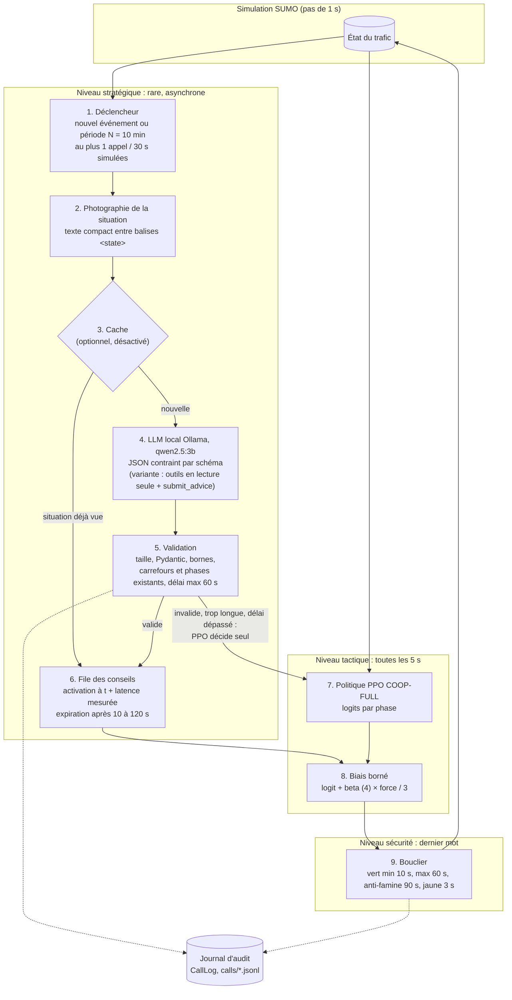

# Le LLM dans la boucle de décision : conception

Document de conception de la partie « LLM dans la boucle » de CoTraffic, complété à chaque
étape : audit et architecture (étape 1), choix du modèle, des réglages et des prompts sur la
graine de validation 1000 uniquement (étape 2, section 8). Convention : **gain positif =
mieux** (moins d'attente que COOP-FULL seul). Document de validation :
[VALIDATION_LLM.md](VALIDATION_LLM.md).

---

## 1. Audit du code existant (mesures du 24/10/2026)

| Point vérifié | Constat | Conséquence pour la conception |
|---|---|---|
| Espace d'actions de COOP-FULL | `Discrete(2)` sur grid4x4 (axe nord-sud ou est-ouest), `Discrete(3)` sur real_district ; observation de 62 et 78 valeurs | Peu de choix par carrefour : un masque d'actions revient à imposer la phase. Le LLM apporte surtout une **vision d'ensemble** (plusieurs carrefours, plusieurs minutes), que la politique locale n'a pas. |
| Accès à la politique | PPO (SB3) : `policy.get_distribution(obs)` donne les logits de chaque phase (déjà utilisé par l'ensemble PPO + DQN) | Un **biais sur les logits** est simple à appliquer et à borner. |
| Politiques déjà entraînées | `coop_full`, `coop_full_ev1`, `coop_full_ev4` (poids des urgences 2, 1 et 4, grille seulement), `coop`, `ind`, `dqn` | Un **changement de mode** est possible sans réentraîner, mais seulement pour les urgences et sur la grille. |
| Environnement | Crochets par seconde de simulation (`step_hooks`), informations sur les ambulances (`ev_info`), accident (`bundle.meta`), capteurs en panne (`sensor_noise.failed`), pertes de messages (`comm_dropout`) | Le détecteur d'événements peut lire ces sources sans modifier l'environnement. |
| Bouclier | `apply_shield` entre la demande et le feu ; jaune géré par le modèle du carrefour ; testé de façon exhaustive | Le conseil du LLM passe **avant** le bouclier : il ne peut jamais produire une séquence dangereuse. |
| libsumo | `simulation.saveState` et `loadState` disponibles | Le jeu de données pour LoRA peut être construit par rollouts courts depuis des états sauvegardés. |
| LLM local | Ollama 0.40.10, un seul modèle installé : `qwen2.5:3b` (1,9 Go) | Le benchmark de l'étape 2 doit télécharger d'autres candidats. |
| Machine | Intel i5-1135G7 (4 cœurs, 8 threads), 11,7 Go de RAM, pas de GPU dédié | Ollama exécute le modèle sur la puce graphique intégrée Iris Xe (« 100% GPU » dans `ollama ps`, constaté à l'étape 2) ; fine-tuning sur GPU externe (Colab ou Kaggle). |
| Durée d'une simulation d'évaluation (sans LLM) | COOP-FULL grille : 88 s (médiane), 207 s (90e centile) ; quartier : 34 s et 69 s | Base pour l'estimation du calcul. |
| Résultats de référence manquants | COOP-FULL n'a pas été évalué sur `sensor_noise` ni `comm_dropout_*` (seulement IND, COOP, MP) | Il faut ajouter ces runs de référence (15 par cellule, environ 1,5 min chacun). |
| Tests actuels | 148 tests pytest, 110 tests Vitest, 38 tests Playwright | Tous doivent continuer à passer. |

### Latence réelle du LLM sur cette machine

Message réaliste (état compact de 16 carrefours et d'une ambulance, environ 430 tokens),
sortie JSON contrainte par schéma, `qwen2.5:3b`, température 0 :

| Budget de sortie | Tokens générés | Latence p50 | Latence p95 | JSON valide |
|---|---|---|---|---|
| 160 tokens | 160 (sortie coupée) | 21,0 s | 25,3 s | 0 / 8 |
| 400 tokens | 283 | 38,0 s | 39,8 s | 6 / 6 |

On en déduit environ 0,14 s par token généré (7 tokens/s). La latence est dominée par la
**longueur de la sortie** : un conseil compact d'environ 40 à 60 tokens devrait coûter de 6
à 10 s. Ce chiffre sera mesuré à l'étape 2. C'est la contrainte qui guide toute
l'architecture.

---

## 2. Revue des travaux existants (références vérifiées)

| Travail | Rôle du LLM | Ce que nous en retenons | Différence avec notre approche |
|---|---|---|---|
| LLMLight (Lai et al., 2023, [arXiv:2312.16044](https://arxiv.org/abs/2312.16044)) | Le LLM choisit lui-même la phase à chaque décision (raisonnement en chaîne) ; modèle dédié LightGPT | Un LLM peut contrôler un feu et justifier ses choix | Appel à chaque décision : impossible sur CPU (21 à 38 s par réponse) ; ici le LLM ne contrôle jamais un feu directement |
| LA-Light (Wang et al., 2024, [arXiv:2403.08337](https://arxiv.org/abs/2403.08337)) | GPT-4 Turbo avec des outils de perception et de décision ; priorité aux véhicules d'urgence ; justification de chaque décision | Les outils et la justification ; gains forts sur les urgences, pas toujours sur le temps de trajet moyen ; la latence est un problème reconnu | Modèle hébergé, sans boucle RL ; nous utilisons un modèle local et un RL comme exécutant |
| iLLM-TSC (Pang et al., 2024, [arXiv:2407.06025](https://arxiv.org/abs/2407.06025)) | Le RL décide d'abord ; le LLM vérifie la décision et la modifie si elle est insuffisante (urgences, observations dégradées) | Le plus proche : RL + LLM, cas rares (urgences, pertes de communication) | Le LLM y intervient à chaque décision ; ici il conseille rarement, avec un délai modélisé, un poids borné et un bouclier qui garde le dernier mot |

Notre positionnement : une architecture **hiérarchique** réaliste pour un LLM local sur
CPU, où le LLM est un conseiller stratégique rare et le RL l'exécutant tactique. Le gain
est mesuré avec le protocole statistique du projet, et un **contrôle placebo** sépare
l'effet du LLM de l'effet d'une simple perturbation.

---

## 3. Architecture et orchestration

Principes :
1. **Le LLM conseille, il ne commande pas.** Sa seule sortie qui agit est un conseil (la
   réponse JSON, ou l'outil `submit_advice`) ; il passe par la validation, devient un biais
   borné sur la politique RL, et le bouclier filtre ensuite la phase demandée.
2. **Repli sûr** : en cas de délai dépassé, de JSON invalide, de réponse trop longue ou de
   conseil rejeté, le RL décide seul, exactement comme sans LLM.
3. **Aucun résultat existant ne change** : le conseiller est une enveloppe
   (`AdvisedPolicy`) autour de COOP-FULL, utilisée par les scripts `llm_*` ; ses runs vont
   dans `results/exploration/`, jamais dans `results/raw`. Son entrée dans la matrice
   d'évaluation, avec une famille Holm « llm » séparée, est prévue à l'étape 4.

### Flux d'un conseil, pas à pas (où c'est dans le code)

| Étape | Ce qui se passe | Code |
|---|---|---|
| 1. Déclencheur | À chaque décision (5 s), un appel part si un événement est nouveau ou si la période N est écoulée, et si aucun appel n'a eu lieu depuis 30 s | `llm/advised.py:104` `_trigger` ; événements `llm/situation.py:109` `events` |
| 2. Situation | Photographie à l'instant `t` : phase, durée du vert, files par phase, piétons de chaque carrefour, événements ; mise en texte et balisage `<state>` (les balises présentes dans les données sont neutralisées) | `llm/situation.py:89` `observe`, `:44` `to_text` ; `llm/prompts.py:38` `messages`, `:47` `wrap` |
| 3. Cache (optionnel) | Même situation qu'un appel précédent (mêmes événements, mêmes phases, files par tranches de 5) : le conseil est réutilisé sans appel. Désactivé par défaut | `llm/advised.py:48` `situation_key`, `:134` |
| 4. Appel au LLM | Ollama local, décodage contraint par le schéma JSON du réseau (carrefours énumérés, bornes), délai maximal 60 s ; variante à outils | `llm/sources.py:67` `LlmSource.advise` ; `llm/client.py:78` `chat` ; `llm/advice.py:45` `schema_for` ; outils `llm/tools.py` |
| 5. Validation | Réponse de plus de 4 000 caractères refusée avant lecture ; lecture stricte (clés, types, bornes) ; une tentative de correction ; puis contrôle contre le réseau (carrefour et phase existants, un conseil par carrefour) | `llm/sources.py:84` ; `llm/advice.py:79` `parse`, `:125` `check` ; `llm/advised.py:152` |
| 6. File et délai | Le conseil validé n'agit qu'à `t + latence mesurée` (ou nulle, ou doublée pour l'analyse de sensibilité), pendant sa durée de validité | `llm/advised.py:119` `_delay`, `:157-159` |
| 7. Activation | À chaque décision : les conseils dont l'heure est venue deviennent actifs, ceux qui ont expiré disparaissent, le plus récent remplace l'ancien sur un carrefour | `llm/advised.py:167` |
| 8. Biais | PPO calcule ses logits (`:189`, la phase qu'il choisirait seul) ; le conseil ajoute `beta × force / 3` à la phase conseillée (`:195`) ; la phase au plus grand logit est demandée (`:198`) | `llm/advised.py:189-198` |
| 9. Bouclier | Le bouclier reçoit la phase demandée et garde le dernier mot (vert minimum, maximum, anti-famine, jaune), comme pour tout contrôleur ; puis SUMO avance | `envs/traffic_env.py:190` `apply_shield`, `:194` |
| 10. Journal | Chaque appel est journalisé : déclencheur, latence, délai, validité, conseil accepté, rejets, tokens | `llm/advised.py` `CallLog` et `summary` ; `results/exploration/llm_period/calls/*.jsonl` |

### Gestion du temps (latence modélisée honnêtement)

- Au temps simulé `t`, un événement ou le minuteur déclenche un appel ; l'état est
  photographié à `t`.
- La simulation attend la réponse (pour connaître son contenu), mais le conseil ne
  s'applique qu'à `t + L`, où `L` est la **latence réelle mesurée de cet appel** ; il agit à
  la première décision (pas de 5 s) qui suit. C'est ce qui se passerait si la simulation
  tournait en temps réel pendant que le LLM réfléchit.
- Chaque conseil a une durée de validité bornée (10 à 120 s) ; il expire ensuite.
- Un seul appel en cours à la fois, et au plus un appel toutes les 30 s simulées.
- Cache des situations identiques : codé (étape 3 ci-dessus) mais **désactivé** ; sur les
  63 situations de validation, 4 répètent une situation précédente (6 % des appels). Il
  n'a pas été évalué.

### Événements détectés (ce que fait le code)

- **Ambulance** : présente dans le réseau, avec les 4 prochains feux de sa route et la phase
  dont elle a besoin à chacun.
- **Accident** : pendant la fenêtre de l'accident du scénario (voie bloquée entre deux
  carrefours).
- **Capteur en panne** : les voies dont le détecteur lit 0 dans le scénario de capteurs
  bruités ; le détecteur suppose la panne signalée (il lit l'information du scénario).
- **Pertes de messages** : dès que des messages entre voisins se perdent, avec le taux.
- **Foule de piétons** : au moins 3 piétons attendent à un carrefour (seuil choisi sur la
  validation : 99e centile 2,9).

### Fréquence d'appel : N = 10 min (mesuré sur la validation)

- Les événements déclenchent un appel immédiat ; la période N ne concerne que les appels
  réguliers.
- N = 3, 5 et 10 min ont été comparés sur des épisodes complets (graine 1000, 6 scénarios,
  section 8). Aucune période n'améliore COOP-FULL en moyenne ; 3 min dégrade nettement les
  piétons (gain −24,8 %). La règle fixée à l'avance retient **10 min** (la plus longue à
  moins de 0,5 point de la meilleure) : 5 appels réguliers par épisode, plus les
  événements.

---

## 4. Mécanismes d'intervention

| Mécanisme | Faisabilité ici | Décision | État |
|---|---|---|---|
| 1. Biais d'action (logits PPO) | Simple, continu, bornable (`beta × force / 3`, force 1 à 3, beta calibré sur la validation : 4) ; laisse le RL arbitrer quand le conseil est faible | **Mécanisme principal** | Fait (`llm/advised.py:195`) |
| 4. Coordination (intentions multi-carrefours) | Exprimée comme un ensemble de biais sur plusieurs carrefours avec une fenêtre temporelle : couloir vert le long de la route d'une ambulance, délestage autour d'un accident | **Intégré au mécanisme principal** | Fait : jusqu'à 4 carrefours par conseil, durée 10 à 120 s |
| 3. Changement de mode | `coop_full_ev4` existe déjà (poids des urgences doublé) ; le LLM pourrait l'activer pendant un événement d'urgence | Second mécanisme envisagé | **Pas réalisé** |
| 2. Masque d'actions | Avec 2 phases, interdire une phase revient à imposer l'autre : le LLM commanderait le feu | Écarté comme mécanisme principal ; ablation envisagée (biais infini) | **Pas réalisée** comme ablation ; le test de sécurité utilise un biais de 1000 (`tests/test_llm_security.py`) |

Pourquoi le biais comme mécanisme principal :
- il garde le RL comme décideur : un conseil faible ne renverse pas une forte préférence du
  RL ;
- son amplitude est un seul paramètre, facile à calibrer et à justifier ;
- il permet un placebo exact : des biais aléatoires de même fréquence et de même amplitude ;
- il se combine naturellement avec la coordination.

---

## 5. Contrôles et comparaisons prévus

| Contrôleur | Rôle | État (validation, graine 1000) |
|---|---|---|
| COOP-FULL | Référence sans LLM (résultats existants, plus les runs manquants sur capteurs et pertes de messages) | Situations et épisodes de validation faits ; runs de test manquants à faire (étape 4) |
| COOP-FULL + LLM zero-shot | Effet du LLM sans exemples | Fait (6 modèles) |
| COOP-FULL + LLM few-shot | Effet des exemples (tirés des graines d'entraînement) | Fait (qwen2.5:3b) |
| COOP-FULL + LLM LoRA | Effet du fine-tuning | Jeu de données et notebook (étape 5) |
| COOP-FULL + conseils aléatoires | **Placebo** : même fréquence, mêmes carrefours visés en nombre, même distribution d'amplitude que le LLM | Source codée (`RandomSource`) ; mesure : oracle et placebo (section 8) |
| COOP-FULL + conseiller à règles | **Contrôle** : les mêmes conseils produits par des règles simples (couloir vert sur la route de l'ambulance, etc.), même mécanisme, même fréquence, même latence | Fait |
| Oracle | Meilleur conseil candidat de chaque situation, choisi après coup par rejeu : borne haute de ce qu'un conseiller peut apporter | Section 8 |
| COOP-FULL + mode urgence (`coop_full_ev4`) choisi par le LLM | Second mécanisme | Pas réalisé |
| LLM seul sur un carrefour (type LLMLight) | Facultatif, épisode court | Pas réalisé |

---

## 6. Plan de la semaine et estimation du calcul

Hypothèses :
- 6 à 10 s par appel au LLM, à confirmer à l'étape 2 ;
- environ 25 appels par épisode de 90 min (18 appels périodiques et les événements) ;
- soit environ 4 min de LLM par run, en plus des 1,5 à 3,5 min de simulation, donc **environ
  6 min par run avec LLM**.

| Lot | Runs | Durée estimée |
|---|---|---|
| Étape 2 : benchmark de 4 à 6 modèles sur un jeu de situations de validation | environ 300 appels | 1 à 2 h |
| Étape 2 : calibration (beta, N, prompts) sur la graine 1000 | environ 40 runs courts | 3 à 4 h |
| Référence COOP-FULL manquante (capteurs, pertes de messages 10, 30 et 50 %) | 60 runs sans LLM | 1 h (2 en parallèle) |
| Placebo et conseiller à règles (6 scénarios) | 180 runs sans LLM | 3 h |
| Zero-shot et few-shot (6 scénarios × 15 runs × 2) | 180 runs avec LLM | 18 h |
| Jeu de données LoRA (rollouts saveState/loadState) | environ 2 000 rollouts courts | 2 à 3 h |
| LoRA sur Colab ou Kaggle (T4 gratuit) | entraînement | 1 à 2 h (GPU externe) |
| LoRA (6 scénarios × 15 runs) | 90 runs avec LLM | 9 h |
| Mode urgence (grille, urgences) | 15 runs avec LLM | 1,5 h |
| **Total** | | **environ 40 h de calcul**, à faire tourner la nuit et pendant les étapes de code |

Scénarios (grille 4x4, pointe), par priorité : accident, urgences, capteurs bruités, pertes
de messages à 30 %, piétons, puis trafic normal (pour vérifier l'absence de dégradation).

Si le temps manque, voici le plan réduit :
- 4 scénarios pour LoRA (accident, urgences, capteurs, pertes de messages) ;
- le trafic normal évalué seulement en zero-shot ;
- soit environ 28 h de calcul.

| Jour | Travail |
|---|---|
| J1 | Étape 1 (cet audit) ; étape 2 : benchmark des modèles, hyperparamètres, prompts |
| J2 | Étape 3 : outils, orchestration, validation, sécurité, tests adverses ; références manquantes en tâche de fond |
| J3 | Étape 4 : pré-enregistrement, puis lancement zero-shot, few-shot, placebo et règles (nuit) |
| J4 | Étape 5 : jeu de données LoRA, notebook Colab, entraînement, conversion GGUF ; prompt tuning si possible |
| J5 | Évaluation LoRA (nuit) ; agrégation, statistiques |
| J6 | Étape 6 : résultats, export ; étape 7 : tableau de bord |
| J7 | Documentation, fiche de soutenance, démo, marge |

---

## 7. Risques identifiés

| Risque | Effet | Parade |
|---|---|---|
| Latence trop forte | Conseils trop tardifs, calcul trop long | Sortie compacte (40 à 60 tokens), modèle plus petit si le benchmark le justifie, cache, N ajusté |
| Peu de marge d'action (2 phases) | Gains faibles | Viser les situations où une vue d'ensemble compte (couloirs, délestage) ; le rapporter honnêtement s'il n'y a pas de gain |
| COOP-FULL déjà bon sur les urgences | Peu de gain mesurable | Comparer aussi à EV-RULE-MP (38 s de retard d'urgence) |
| Non-déterminisme du LLM sur CPU | Reproductibilité imparfaite | Température 0, graine fixe, digest du modèle et chaque réponse journalisés ; les runs sont rejouables à partir des journaux |
| Pas de GPU local | Fine-tuning impossible sur la machine | Colab ou Kaggle ; à défaut, modèle plus petit et résultats marqués « préliminaires » |
| Charge de calcul (environ 40 h) | Retard | Plan réduit prêt ; les lots sans LLM tournent en parallèle |
