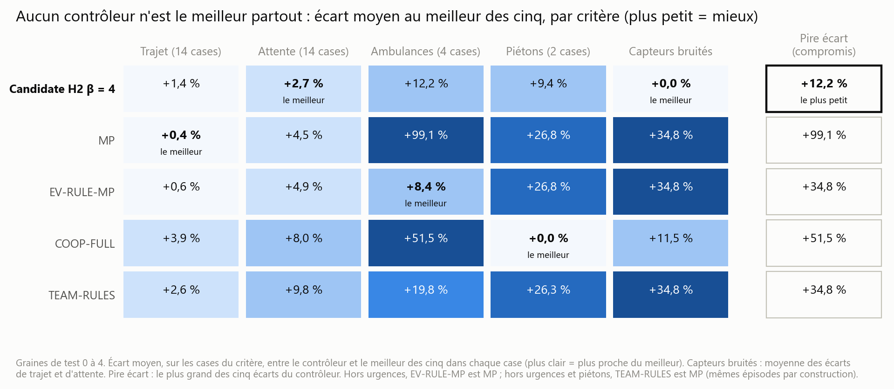
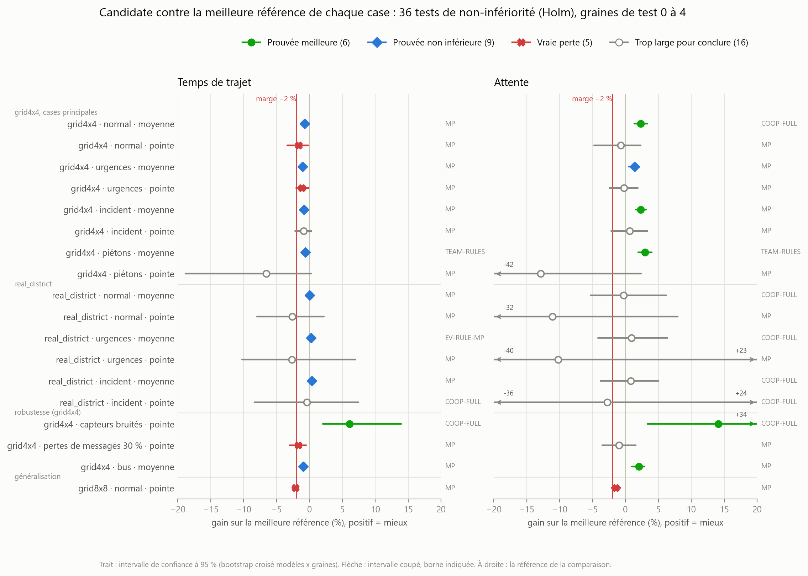
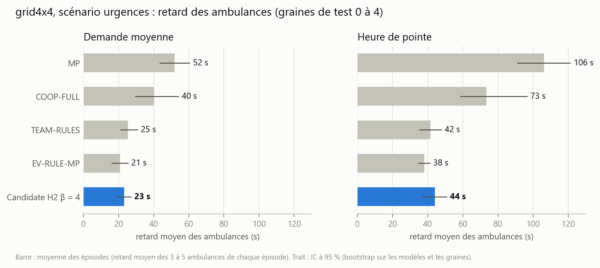

# Le contrôleur final en une page

Étude combinée de CoTraffic : peut-on assembler nos briques (PPO coopératif COOP-FULL,
Max-Pressure, préemption des ambulances, règles piétons, LLM) en un contrôleur de feux qui
ne soit jamais moins bon que la meilleure référence ? Résultats de l'évaluation finale, faite
**une seule fois**, sur des graines de test jamais utilisées pour régler quoi que ce soit.

## Le contrôleur retenu

**H2 β = 4** : à chaque décision (toutes les 5 s), le réseau PPO COOP-FULL propose une phase ;
on pousse sa préférence vers la phase que choisirait Max-Pressure (un bonus de 4 sur son
score) ; une ambulance à moins de 200 m d'un feu prend la priorité (EV-RULE) ; le bouclier de
sécurité a toujours le dernier mot. Pas de LLM dans la décision.

Il a été choisi parmi 15 variantes, sur trois graines de validation (1000, 1001, 1002) : il y
est premier, ou à égalité avec le premier. La seule variante qui l'égale (H3, qui passe à
Max-Pressure quand l'entrée du réseau sature) a les mêmes épisodes que lui presque partout, et
fait moins bien là où elle s'en écarte.

## Le message principal : le meilleur compromis, pas le meilleur partout

Aucun contrôleur n'est le meilleur sur tous les critères. Max-Pressure est le plus rapide en
temps de trajet mais laisse attendre les ambulances (deux fois plus longtemps que la
candidate) ; EV-RULE-MP
sert le mieux les ambulances mais souffre des capteurs bruités ; COOP-FULL sert le mieux les
piétons mais s'engorge en pointe. **La candidate n'est jamais loin du meilleur : son plus
grand écart est de 12 %, contre 35 à 99 % pour les autres.** Elle est la meilleure sur
l'attente et sous capteurs bruités.

## Ce qu'on peut affirmer

Contre la meilleure référence de chaque case (36 comparaisons : 18 situations x temps de
trajet et attente), avec la correction de Holm :

- **non moins bonne, à 2 % près, dans 15 comparaisons** : partout en demande moyenne sur la
  grille, sur le temps de trajet de real_district en demande moyenne, avec des bus, avec des
  capteurs bruités ;
- **meilleure dans 6** : l'attente en demande moyenne sur la grille (+2 à +3 %) et, avec des
  capteurs bruités, le trajet (+6 %) et l'attente (+14 %) ;
- **les ambulances** (sans test, mesure secondaire) : retard divisé par deux par rapport à
  Max-Pressure sur la grille (23 s contre 52 s en demande moyenne, 44 s contre 106 s en pointe),
  proche de la meilleure règle dédiée (EV-RULE-MP : 21 s et 38 s).

## Ce qu'on ne peut pas affirmer

- **« Jamais moins bonne partout » n'est pas démontré** : 21 comparaisons sur 36 ne passent
  pas.
- **5 vraies pertes**, petites, toutes contre Max-Pressure : le temps de trajet en pointe sur
  la grille (−1,2 à −1,7 %) et sur grid8x8 (trajet −2,1 %, attente −1,5 %).
- **16 intervalles trop larges pour conclure** : surtout real_district en pointe, et l'attente
  sur real_district (quelques secondes seulement, donc des écarts relatifs très variables).
- **Remarque honnête** : dans deux de ces cas « trop larges », l'estimation est nettement
  défavorable. Sur real_district en pointe (−0,4 à −11 % selon la situation et la mesure) et sur la grille
  avec piétons en pointe (−6,6 % de trajet, −12,9 % d'attente), la candidate fait
  probablement moins bien que Max-Pressure : 5 graines ne suffisent pas à le démontrer, mais
  la validation allait dans le même sens. Avec piétons en pointe, la candidate s'engorge
  parfois ; COOP-FULL seul s'engorge plus souvent et plus fort.

Le tableau par référence (combien de critères meilleurs, égaux ou moins bons) est dans
`results/combined/bilan_references.md` ; chaque test est dans `results/combined/analysis.md`.

## Le LLM : un résultat négatif, mesuré

- **Avant de construire un LLM qui choisirait la stratégie, on a mesuré ce qu'un choix parfait
  rapporterait** (l'oracle) : même en choisissant la meilleure stratégie toutes les 5 minutes,
  avec la connaissance du futur, le gain sur le temps de trajet ne dépasse jamais 2,2 %. Le
  critère fixé à l'avance (un gain de plus de 3 % dans au moins 4 situations sur 14, et mieux
  que le hasard) n'était rempli que dans 3. Il n'y avait donc pas de place pour un LLM
  stratège, et on ne l'a pas construit.
- **Le conseiller LLM local (qwen2.5:3b) ajouté à la candidate**, sur une situation de test
  (grille, urgences, pointe, 5 graines) : techniquement tout marche (100 % de réponses JSON
  valides, aucun repli, 7,9 s par réponse), mais il fait **un peu moins bien** que la
  candidate seule : trajet −1,4 %, attente −2,9 %, ambulances 49 s contre 40 s. Avec 5
  graines, ce n'est pas une preuve, mais rien n'indique un apport.
- **Limite connue** : le coût de l'oracle ne comptait pas les voitures bloquées à l'entrée du
  réseau ; dans les cas saturés, il sous-estime ce qu'une stratégie pourrait gagner. Sa
  conclusion vaut donc pour les cas non saturés.

## Comparaison indirecte avec la version LLM de notre coéquipier (exploratoire)

Sa meilleure version utilise un LLM hébergé (DeepSeek V4.1 Flash, appelé par une API). Elle
n'a pas été évaluée dans notre étude, qui n'utilise qu'un LLM local. On ne peut donc comparer
que de façon **indirecte** : chacun par rapport à Max-Pressure, sur real_district, le seul
réseau qu'il a mesuré. Gain par rapport à Max-Pressure, positif = mieux :

| Situation (real_district) | Son équipe LLM (API), son compte rendu | Notre candidate, graines de test 0 à 4 |
|---|---|---|
| normal, demande moyenne | trajet +0,2 % ; attente +2,4 % | trajet 0,0 % ; attente **+8,8 %** |
| urgences, demande moyenne | trajet +0,5 % ; attente +4,4 % ; ambulances +2,2 % | trajet +0,3 % ; attente **+10,9 %** ; ambulances **+21,7 %** |
| incident, demande moyenne | trajet +0,4 % ; attente +3,6 % | trajet +0,4 % ; attente **+11,4 %** |
| normal, pointe | trajet −8,9 % ; attente −29,4 % | trajet −2,6 % ; attente −11,1 % |
| urgences, pointe | trajet −3,8 % ; attente −15,6 % ; ambulances −30,8 % | trajet −2,7 % ; attente −10,2 % ; ambulances +13,3 % |

Lecture : en demande moyenne, les deux font comme Max-Pressure sur le temps de trajet, et la
candidate fait nettement mieux sur l'attente et les ambulances ; en pointe, les deux perdent
contre Max-Pressure, mais la candidate perd beaucoup moins.

**Limites, à dire avant le chiffre.**

- Ce n'est pas le même essai : ses chiffres viennent de son propre compte rendu, avec son
  protocole (sa version de l'environnement, ses durées d'épisode, ses graines 0 à 2) ; nous ne
  les avons pas rejoués. Seuls les écarts à Max-Pressure sont comparés, pas les valeurs.
- Son échantillon est petit : 3 graines en demande moyenne, **une seule** en pointe ; aucun
  intervalle de confiance de son côté. Les nôtres sont larges en pointe (par exemple
  l'attente en pointe normale : intervalle de −32 % à +8 %).
- Un seul réseau, cinq situations.
- Hors pré-enregistrement : c'est une indication, pas une preuve. Une comparaison directe
  demanderait de faire tourner sa version API dans notre protocole.

## La rigueur

- **Pré-enregistrement** : contrôleurs, situations, graines, tests et règles de décision écrits
  et figés avant toute graine de test (`docs/COMBINED_PREREGISTRATION.md`, commit `2c0dd1d`) ;
  le script d'évaluation refusait de démarrer si un seul fichier figé avait changé.
- **Évaluation unique** : 1 265 épisodes de 1 h 30 simulée, sur les graines de test 0 à 4,
  avec 3 modèles PPO entraînés indépendamment ; 18 situations (2 réseaux, urgences, incident,
  piétons, bus, capteurs bruités, pertes de messages, grid8x8 sans réentraînement) ; aucun
  plantage, aucun épisode rejoué.
- **Statistiques** : intervalles de confiance par bootstrap (modèles et graines), correction de
  Holm, marge de non-infériorité de 2 %, et une règle fixée d'avance pour distinguer « vraie
  perte » et « trop large pour conclure ».
- **Reproductibilité vérifiée** : la même simulation rejouée donne exactement le même épisode
  (20 épisodes rejoués deux fois, identiques) ; les deux façons de piloter SUMO (libsumo et
  TraCI) donnent les mêmes épisodes (8 épisodes, 53 à 110 mesures chacun, toutes identiques) ;
  chaque résultat enregistre le commit du code qui l'a produit.
- **Tout est rapporté** : les 15 variantes essayées en validation, pas seulement la meilleure
  (`results/exploration/combined/rank_s100*.md`).

## Qui a fait quoi

**Notre coéquipier** a conçu
l'**équipe de LLM** : un superviseur, un arbitre et trois rôles (opérateur, urgences,
piétons) qui envoient des consignes à Max-Pressure, avec des règles de secours écrites en
code. Dans cette étude :

- son code est repris tel quel, fichier par fichier, avec l'empreinte de chaque fichier et les
  trois seules modifications signalées (`src/cotraffic/controllers/llm_team/PROVENANCE.md`) ;
- **TEAM-RULES** est son contrôleur avec ses règles, sans appel au LLM ; c'est une des quatre
  références que la candidate devait égaler ;
- ses règles piétons ont été testées sur COOP-FULL (aussi bonnes que notre règle PED-RULE) ;
- sa version avec un LLM hébergé n'a pas été évaluée ici : l'étude n'utilise qu'un LLM local.

**Notre travail** : l'environnement de simulation et le protocole d'évaluation, l'agent
COOP-FULL (PPO coopératif) et ses trois entraînements, les références Max-Pressure, EV-RULE et
PED-RULE, le bouclier de sécurité, le conseiller LLM local, et toute l'étude combinée :
l'adaptateur qui fait tourner son équipe dans notre protocole, les hybrides H1 à H3, l'oracle
de stratégie et son placebo, le pré-enregistrement, l'évaluation finale, l'analyse et ces
figures.
