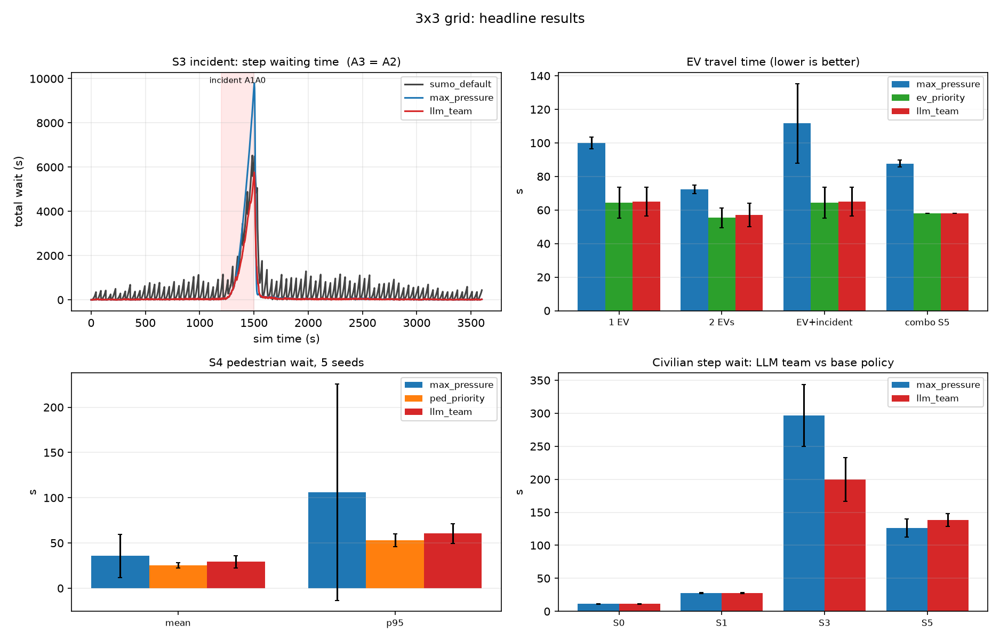
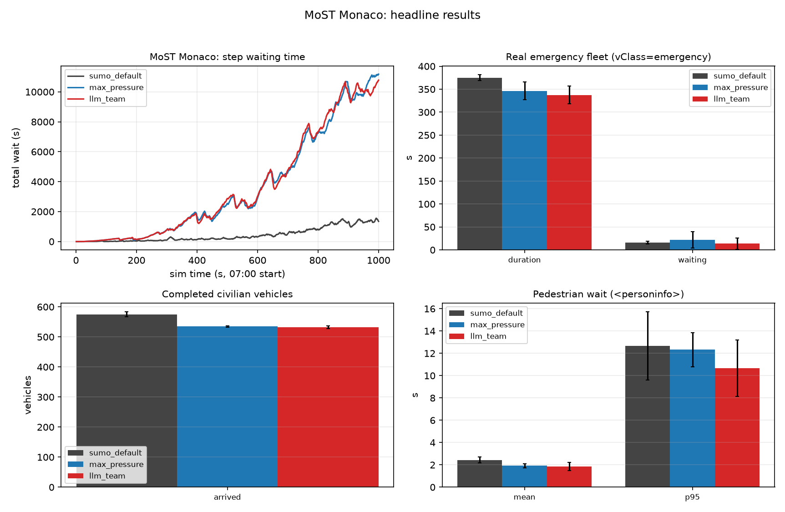
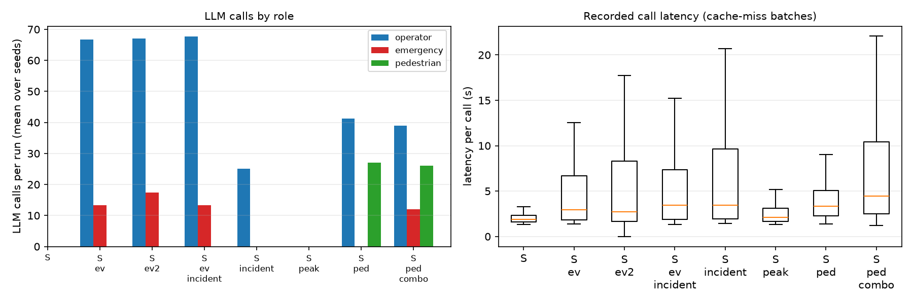

# Evaluation report: LLM agents on the 3x3 grid and MoST Monaco

A max-pressure fast layer (every 1 s, with min-green, yellow and starvation
safety in code) is supervised by three LLM agents: an **Operator** (network
wide bias/hold), an **Emergency** agent (green corridors for
`vClass=emergency` vehicles, with a deterministic reviewer and FCFS scheduler)
and a **Pedestrian** agent (crossing windows). Every LLM proposal is a typed
directive validated by an arbiter; a directive layer applies it, and the fast
layer continues unchanged when an agent fails. The system is measured against
SUMO's own controllers and rule-based baselines on a 3x3 grid and on the real
MoST Monaco network. Model: `deepseek-v4.1-flash`, temperature 0.

Regenerate everything from the recorded runs in `results/`:

```bash
~/.venvs/sumo/bin/python evaluation/collect_results.py   # tables/
~/.venvs/sumo/bin/python evaluation/report_plots.py      # figures/
```

## Setup

| | 3x3 grid | MoST Monaco |
|---|---|---|
| Network | 9 TLS, fixed 4-state signal programs, synthetic demand | 12 TLS, actuated programs with 2 or 3 vehicle-green sets, real multimodal demand |
| Scenarios | S0 to S5 (legend below) | 07:00 morning-peak slice, 17 min (1000 steps, 1 s step length) |
| Arms | `sumo_default`, `fixed`, `max_pressure`, `ev_priority`, `ped_priority`, `llm_team` | `sumo_default` (MoST actuated), `max_pressure`, `llm_team` |
| Seeds | 3 (5 for the pedestrian scenario) | 3 |

The grid scenarios are referenced by ID in the tables and figures:

| ID | Scenario | Content |
|---|---|---|
| S0 | Normal demand | 1,200 vehicles over 1 h. Regression check: the LLM layer must not harm the base policy |
| S1 | Peak demand | 2x demand (2,400 vehicles) |
| S2 | EV runs | `ev` (1 EV at t=600), `ev2` (2 overlapping EVs), `ev_incident` (EV plus an edge blocked 620 to 860 s) |
| S3 | Incident | Interior edge A1A0 blocked from 1200 to 1500 s, teleport off |
| S4 | Pedestrian surge | 360 pedestrians burst at B1 between 300 and 540 s, 1200 s horizon |
| S5 | Composed | All three at once: EV at t=450, pedestrian burst 300 to 540 s, incident (A1A0 blocked 400 to 640 s) |

## Grid results



| Hypothesis | Decisive metric | Base (`max_pressure`) | `llm_team` | Rule baseline | Verdict |
|---|---|---|---|---|---|
| No regression, normal demand | mean step wait (s) | 11.30 ± 0.26 | 11.30 ± 0.26 | | tie, step logs bit-identical |
| EV travel time | EV duration (s), 1 EV | 100.00 ± 3.46 | 65.00 ± 8.72 | `ev_priority` 64.33 ± 9.24 | win vs base, tie vs rule |
| EV travel time | EV duration (s), 2 EVs | 72.33 ± 2.57 | 57.00 ± 6.93 | 55.33 ± 5.77 | win vs base, -3% vs rule |
| Incident recovery | mean step wait (s) | 296.68 ± 47.19 | 199.78 ± 33.45 | | win, -32.7% |
| Pedestrian surge | ped mean / p95 wait (s) | 35.70 / 106.2 | 29.20 / 60.4 | `ped_priority` 25.29 / 53.0 | win, no vehicle penalty |
| Composed EV+incident+pedestrians | EV duration / ped mean / civilian step wait (s) | 87.67 / 29.88 / 126.29 | 58.00 / 24.12 / 138.43 | EV rule 58.00 / 23.85 / 141.05; ped rule 88.67 / 28.60 / 144.84 | matches the EV rule exactly and takes the best pedestrian waits at a smaller civilian cost than either single-purpose rule |

The incident is the cleanest win: the code-side queue-growth alert plus the
operator rule learned from the logs ("a queue that grows while its axis is
green signals downstream blockage; stop feeding it green") cut the spillback
peak and clear the aftermath faster (panel 1). Pre-emption shields the EV from
the incident completely; the incident cost lands on civilian flow.

## Monaco results



| Arm | Step wait (s) | Arrived vehicles | Civilian tripinfo wait (s) | EV duration (s) | EV waiting (s) | Ped p95 (s) |
|---|---|---|---|---|---|---|
| `sumo_default` (MoST actuated) | **432 ± 16** | **575.0 ± 8.5** | **15.37 ± 0.34** | 375.17 ± 6.79 | 16.02 ± 2.79 | 12.67 ± 3.06 |
| `max_pressure` | 3555 ± 141 | 534.7 ± 2.3 | 20.50 ± 1.00 | 346.29 ± 19.56 | 22.29 ± 17.94 | 12.33 ± 1.53 |
| `llm_team` | 3593 ± 73 | 532.0 ± 4.0 | 21.85 ± 0.34 | **337.59 ± 19.41** | **13.51 ± 12.33** | **10.67 ± 2.52** |

Takeaway, in order of importance: (1) MoST's tuned actuated programs beat both
signal-pinned arms on car metrics by about 7% arrivals and a visibly lower
standing-time curve, because a queue-greedy controller with a 10 s minimum
green and no gap-out is simply not competitive on this network; (2) the fair
comparison is `llm_team` vs `max_pressure`, where the LLM layer is neutral on
cars and consistently better on the real emergency fleet: EV duration lower on
all 3 seeds, EV waiting -39% (13.5 vs 22.3 s), and pedestrian p95 is the best
of the three arms. Deterministic validation covers this: strict replay of all
three seeds is bit-identical on every metric, and a 400-step check confirms
that after the actuated programs are converted to static copies SUMO never
advances a signal behind the controller.

## LLM operations



| Runs | Calls per run | Roles | Median latency | Fallbacks |
|---|---|---|---|---|
| Grid, quiet/peak (S0, S1) | 60 to 61 | operator | 1.9 to 2.2 s | 0 |
| Grid, incident and EV runs | 74 to 87 | operator, emergency | 2.8 to 9.9 s | 0 |
| Grid, pedestrian runs | 60 to 87 | operator, emergency, pedestrian | 3.3 to 4.5 s | 0 |
| Monaco | 334 to 356 | operator 66 to 68, emergency 266 to 289 | 24.6 to 26.6 s | 0 |

Two cost notes: the Emergency agent's event triggers dominate Monaco call
volume, and Monaco prompts reach about 30k input tokens per call because about
20 emergency vehicles are concurrently active, so the prompt changes on nearly
every call and provider caching barely helps. Pruning the per-EV upcoming-lights
list in the snapshot is the obvious next lever.

## Auditability

The logs are the answer to "why did the signal change". Two examples from the
recorded decisions.

Incident rule (S3, block A1A0): the operator first favors the growing queue,
then stops feeding green to the blocked axis and stays consistent until the
incident clears.

```
t=1327 operator [bias A0 ns=1.2 ew=0.9]  "A0 is the only loaded junction and its NS
      approach leads on both queue and wait, so nudge green toward NS to drain it."
t=1350 operator [bias A0 ns=0.6 ew=1.5]  "NS at A0 stays jammed while its green yields
      almost nothing, suspected downstream blockage, so I hold service on the EW axis."
```

Monaco corridor with exact-group pinning and FCFS sequencing (two EVs needing
one junction; `phase_index=2` selects the specific green set, the later EV is
sequenced after the earlier window):

```
note: "142742: special_1-1_115 start delayed to 12.9s (serve the earlier arrival first)"
accepted: 142742 EW (special_1-1_115), 142742 NS phase_index=2 (special_1-3_187),
          cluster NS, 146640 NS
```

## Limitations

- The peak-demand pedestrian variant is a measured null result: with heavy
  vehicles, queue-driven cycling already serves crossings and forced windows
  cost transitions. It is reported, not hidden.
- No agent ablations on the composed scenario (Operator-only and
  Emergency-only runs were not recorded).
- Monaco ran a 17-minute morning-peak slice at 1 s steps (MoST recommends
  0.25 s and a longer window); the controlled arms pay a car-metric price
  against MoST's actuated baseline, documented above.
- EV and pedestrian KPIs count completed trips and persons only; anything
  still en route at the horizon is invisible to `<tripinfo>`.
- On the 2-EV conflict the LLM team remains about 3% behind the per-second
  rule baseline, which is release granularity, not planning quality.

## Full detail

- `grid_3x3.md`: hypotheses H1 to H5 with all tables, figures and excerpts.
- `monaco.md`: scenario setup, static-program conversion and k-group control
  notes, full results and limitations.
- `tables/`: `all_results.csv`, `llm_ops.csv`, per-scenario arms x seeds tables.
- `figures/`: all step-wait curves, bar panels and the two headline figures.
