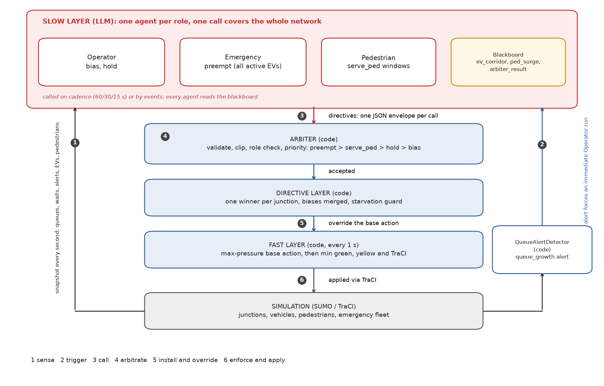

# Evaluation report: LLM agents on the 3x3 grid and MoST Monaco

Three LLM agents supervise a max-pressure fast layer: Operator (network-wide
bias/hold), Emergency (EV corridors), Pedestrian (crossing windows). They only
propose typed directives; code validates and enforces everything, so agent
failures leave the fast layer unchanged. Tested against SUMO's own controllers
and rule-based baselines on the 3x3 grid and MoST Monaco.
Model: `deepseek-v4.1-flash`, temperature 0.

## Architecture

One LLM agent per role, batched for the whole network: no agent per junction,
car or EV. The LLM only proposes typed directives; code decides and enforces.



| Agent | One call covers | Runs when | Emits | On failure |
|---|---|---|---|---|
| Operator | the whole network | cadence 60/30/15 s by congestion, plus any code alert | `bias`, `hold`, explanation | nothing, fast layer continues |
| Emergency | all active EVs, corridor view per EV | every 10 s while EVs run, plus EV events | `preempt` windows, corridor message | rule-based pre-emption |
| Pedestrian | all waiting crossings | 30 s, plus wait events | `serve_ped` windows, surge message | rule-based windows |

Safety chain: directives go to the Arbiter (validate, clip, priority), then the
DirectiveLayer (one winner per junction, starvation guard), then
TrafficLightAgent (min green, yellow, TraCI). Agents share state through a TTL
blackboard: `ev_corridor`, `ped_surge`, `arbiter_result`. Incidents are
scripted in the experiment; the code detector turns their effect into a
`queue_growth` alert that runs the Operator immediately.

## Setup

| | 3x3 grid | MoST Monaco |
|---|---|---|
| Network | 9 TLS, fixed 4-state signal programs, synthetic demand | 12 TLS, actuated programs with 2 or 3 vehicle-green sets, real multimodal demand |
| Scenarios | S0 to S5 (legend below) | 07:00 morning-peak slice, 17 min (1000 steps, 1 s step length) |
| Arms | `sumo_default`, `fixed`, `max_pressure`, `ev_priority`, `ped_priority`, `llm_team` | `sumo_default` (MoST actuated), `max_pressure`, `llm_team` |
| Seeds | 3 (5 for the pedestrian scenario) | 3 |

The grid scenarios are referenced by ID in the tables and figures:

| ID | Scenario | Content |
|---|---|---|
| S0 | Normal demand | 1,200 vehicles over 1 h. Regression check: the LLM layer must not harm the base policy |
| S1 | Peak demand | 2x demand (2,400 vehicles) |
| S2 | EV runs | `ev` (1 EV at t=600), `ev2` (2 overlapping EVs), `ev_incident` (EV plus an edge blocked 620 to 860 s) |
| S3 | Incident | Interior edge A1A0 blocked from 1200 to 1500 s, teleport off |
| S4 | Pedestrian surge | 360 pedestrians burst at B1 between 300 and 540 s, 1200 s horizon |
| S5 | Composed | All three at once: EV at t=450, pedestrian burst 300 to 540 s, incident (A1A0 blocked 400 to 640 s) |

## Grid results


| Hypothesis | Decisive metric | Base (`max_pressure`) | `llm_team` | Rule baseline | Verdict |
|---|---|---|---|---|---|
| No regression, normal demand | mean step wait (s) | 11.30 ± 0.26 | 11.30 ± 0.26 | | tie, step logs bit-identical |
| EV travel time | EV duration (s), 1 EV | 100.00 ± 3.46 | 65.00 ± 8.72 | `ev_priority` 64.33 ± 9.24 | win vs base, tie vs rule |
| EV travel time | EV duration (s), 2 EVs | 72.33 ± 2.57 | 57.00 ± 6.93 | 55.33 ± 5.77 | win vs base, -3% vs rule |
| Incident recovery | mean step wait (s) | 296.68 ± 47.19 | 199.78 ± 33.45 | | win, -32.7% |
| Pedestrian surge | ped mean / p95 wait (s) | 35.70 / 106.2 | 29.20 / 60.4 | `ped_priority` 25.29 / 53.0 | win, no vehicle penalty |
| Composed EV+incident+pedestrians | EV duration / ped mean / civilian step wait (s) | 87.67 / 29.88 / 126.29 | 58.00 / 24.12 / 138.43 | EV rule 58.00 / 23.85 / 141.05; ped rule 88.67 / 28.60 / 144.84 | matches the EV rule exactly and takes the best pedestrian waits at a smaller civilian cost than either single-purpose rule |

Cleanest win: the queue-growth alert plus one learned rule ("a queue that
grows while its axis is green signals downstream blockage") cuts the spillback
peak. Pre-emption shields the EV entirely; civilians pay.

## Monaco results


| Arm | Step wait (s) | Arrived vehicles | Civilian tripinfo wait (s) | EV duration (s) | EV waiting (s) | Ped p95 (s) |
|---|---|---|---|---|---|---|
| `sumo_default` (MoST actuated) | **432 ± 16** | **575.0 ± 8.5** | **15.37 ± 0.34** | 375.17 ± 6.79 | 16.02 ± 2.79 | 12.67 ± 3.06 |
| `max_pressure` | 3555 ± 141 | 534.7 ± 2.3 | 20.50 ± 1.00 | 346.29 ± 19.56 | 22.29 ± 17.94 | 12.33 ± 1.53 |
| `llm_team` | 3593 ± 73 | 532.0 ± 4.0 | 21.85 ± 0.34 | **337.59 ± 19.41** | **13.51 ± 12.33** | **10.67 ± 2.52** |

- MoST's tuned actuated programs beat both controlled arms on cars (about 7%
  fewer arrivals): the signal-pinned base policy is the bottleneck, not the LLM.
- The fair comparison, `llm_team` vs `max_pressure`: neutral on cars, clearly
  better on the real emergency fleet (waiting -39%, 13.5 vs 22.3 s) and on
  pedestrian p95, on all 3 seeds.
- Strict replay of all seeds is bit-identical, so these numbers are faithful.

## LLM operations


| Runs | Calls per run | Roles | Median latency | Fallbacks |
|---|---|---|---|---|
| Grid, quiet/peak (S0, S1) | 60 to 61 | operator | 1.9 to 2.2 s | 0 |
| Grid, incident and EV runs | 74 to 87 | operator, emergency | 2.8 to 9.9 s | 0 |
| Grid, pedestrian runs | 60 to 87 | operator, emergency, pedestrian | 3.3 to 4.5 s | 0 |
| Monaco | 334 to 356 | operator 66 to 68, emergency 266 to 289 | 24.6 to 26.6 s | 0 |

Cost notes: Monaco calls are slow and large because about 20 EVs are active at
once (about 30k input tokens per call, prompt caching barely helps). Pruning
the per-EV upcoming-lights list is the next lever.

## Auditability

The logs answer "why did the signal change". Incident rule (S3): stop feeding
green to a blocked axis, stay consistent while the alert lasts.

```
t=1327 operator [bias A0 ns=1.2 ew=0.9]  "A0 is the only loaded junction and its NS
      approach leads on both queue and wait, so nudge green toward NS to drain it."
t=1350 operator [bias A0 ns=0.6 ew=1.5]  "NS at A0 stays jammed while its green yields
      almost nothing, suspected downstream blockage, so I hold service on the EW axis."
```

Monaco corridor: exact green-set pinning plus FCFS sequencing when two EVs
need one junction.

```
note: "142742: special_1-1_115 start delayed to 12.9s (serve the earlier arrival first)"
accepted: 142742 EW (special_1-1_115), 142742 NS phase_index=2 (special_1-3_187),
          cluster NS, 146640 NS
```

## Limitations

- Peak-demand pedestrians: measured null, reported as such.
- No Operator-only or Emergency-only ablations on the composed scenario.
- Monaco: 17-minute slice at 1 s steps; the controlled arms pay a car-metric
  price against the actuated baseline.
- KPIs count completed trips and persons only.
- 2-EV conflict: the LLM stays about 3% behind the per-second rule.

## Full detail

Regenerate everything from the recorded runs in `results/`:

```bash
~/.venvs/sumo/bin/python evaluation/collect_results.py   # tables/
~/.venvs/sumo/bin/python evaluation/report_plots.py      # figures/
```

- `grid_3x3.md`: hypotheses H1 to H5 with all tables, figures and excerpts.
- `monaco.md`: scenario setup, static-program conversion and k-group control
  notes, full results and limitations.
- `tables/`: `all_results.csv`, `llm_ops.csv`, per-scenario arms x seeds tables.
- `figures/`: step-wait curves, bar panels, headline figures and the
  architecture diagram.
