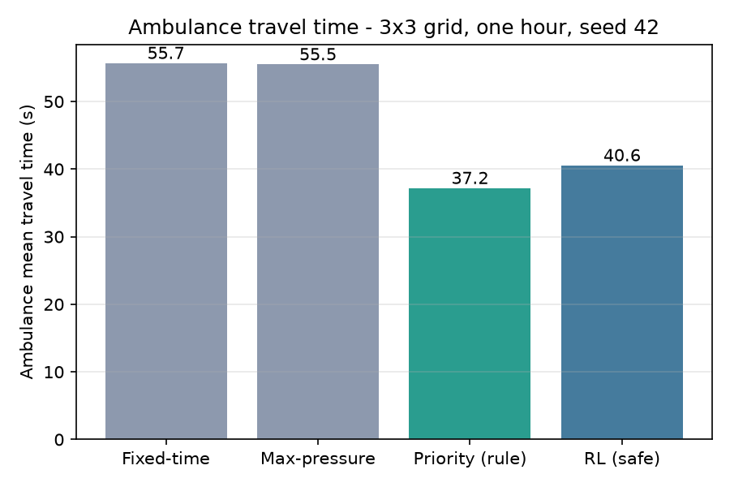
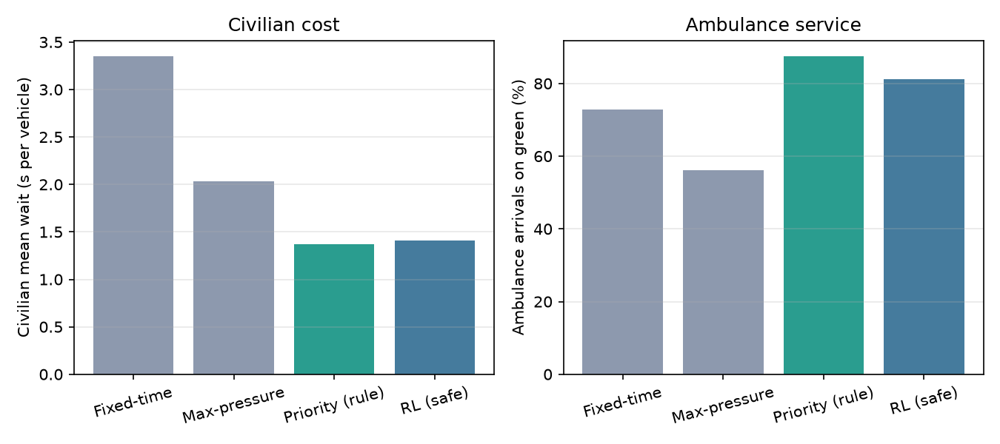
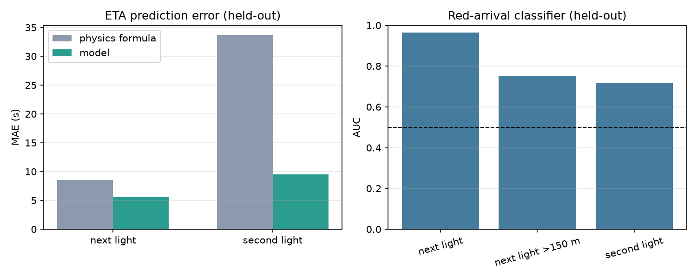
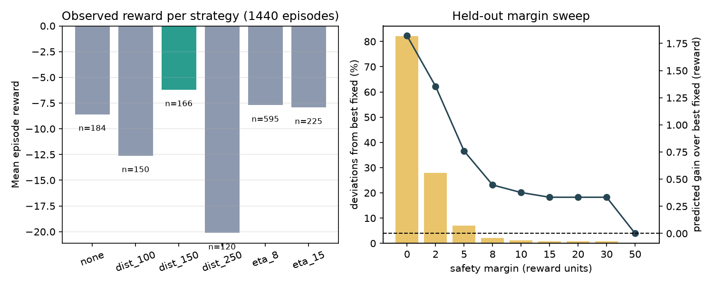

# Emergency Vehicle Priority

Amen Allah Ben Aissa. Branch: `amen/ev-priority`.

Goal: get ambulances through the signalized 3x3 grid with minimal delay (E1),
predict their arrival at each traffic light (E2), and test a reinforcement
learning layer that decides when pre-emption is worth it (M4).

## Showcase commands

### 1. Live demo: priority policy with model predictions (main demo)

```bash
/home/logmoon/.venvs/sumo/bin/python experiments/run_ev_priority.py \
    --scenario 3x3 --mode priority --gui --delay 100 --steps 1200 \
    --show-predictions --predict-every 10 --no-summary
```

What you see:
- SUMO-GUI runs about 2 minutes (20 simulated minutes).
- A red ambulance spawns every ~4 minutes, rotating over six fixed routes.
- The terminal prints the models live, for example:
  `[pred] t=10s ev_0 -> A1 dist=192m light=G ETA=20.7s P(red)=0.12`
- Watch the light switch or hold green for the ambulance direction. Yellow and
  minimum green are always enforced; the policy only expresses a preference.

What to point out: the GUI shows the behavior, the terminal shows the models
behind it (predicted arrival seconds and probability of arriving on red).

### 2. Live baseline: same scene, no priority

```bash
/home/logmoon/.venvs/sumo/bin/python experiments/run_ev_priority.py \
    --scenario 3x3 --mode fixed --gui --delay 100 --steps 1200 --no-summary
```

### 3. Offline model demo (terminal only)

```bash
/home/logmoon/.venvs/sumo/bin/python showcase/model_demo.py
```

Prints three real held-out traffic states: the model prediction, the physics
baseline, and what actually happened.

### 4. Regenerate the figures and the results table

```bash
/home/logmoon/.venvs/sumo/bin/python experiments/make_report_figures.py
```

## Results (3x3 grid, one hour, seed 42)

| Controller | EV time (s) | EV wait (s) | Red stops | Green arrivals (%) | Civilian wait (s/veh) | Throughput |
|---|---|---|---|---|---|---|
| Fixed-time | 55.7 | 17.8 | 15 | 72.9 | 3.35 | 1196 |
| Max-pressure | 55.5 | 15.2 | 23 | 56.2 | 2.03 | 1196 |
| **Priority (rule)** | **37.2** | **2.4** | **6** | **87.5** | **1.37** | 1196 |
| RL (safe margin) | 40.6 | 5.1 | 7 | 81.2 | 1.41 | 1197 |

The rule cuts ambulance travel time by 33 percent versus fixed-time, removes
most red-light stops, and does not hurt normal traffic (civilian wait is lower
than both baselines).




## Models

All models share one feature extractor (12 inputs per ambulance and upcoming
light): distance, speed, acceleration, leader gap, vehicles on lane, signal
color, time to switch, time in phase, turn flag, plus the same signal and
distance features of the first upcoming light. Second-light predictions
therefore know about the first stop.

### ETA regression (`forecasting/ev_arrival_predictor.py`)

- Input: 12 features. Output: seconds until the ambulance passes that light.
- Held-out error (runs never seen in training):

| | next light | second light |
|---|---|---|
| physics formula | 8.6 s | 33.7 s |
| **model** | **5.6 s** | **9.5 s** |

### Red-arrival classifier (same file)

- Input: 12 features. Output: probability the ambulance reaches that light on
  a non-green signal.
- Held-out AUC: 0.965 next light, 0.752 next light beyond 150 m, 0.715 second
  light.
- Status: trained and saved (`ev_red.joblib`) but not wired into control. It
  is an evaluated signal for the report and for future use.



### RL policy (`agents/emergency_rl.py`)

- One decision per ambulance and light: choose one of six strategies (do
  nothing, pre-empt at 100/150/250 m, ETA-trigger at 8/15 s).
- Reward: minus (ambulance waiting seconds + 0.25 times civilian wait seconds).
- Trained by fitted Q-iteration on 1,440 decision episodes (random then guided
  exploration) and evaluated online with a safety margin.

Honest outcome: on this grid, held-out data justified no deviation from the
best fixed strategy, so the safe policy converges to the rule-based one. The
pipeline works and is ready for harder scenarios (longer corridors, heavier
traffic).



## Limitations

- Baselines measured on seed 42 only; priority has 3-seed support.
- RL mode has a small residual mechanics gap versus priority mode (40.6 s
  versus 37.2 s on seed 42), under investigation.
- ETA-triggered early green was neutral on this grid; kept behind an
  environment flag, default off.
- The classifier is not used in control yet.

## Full reproduction

```bash
# results table and all figures
/home/logmoon/.venvs/sumo/bin/python experiments/make_report_figures.py

# rule-based priority, full hour
/home/logmoon/.venvs/sumo/bin/python experiments/run_ev_priority.py \
    --scenario 3x3 --mode priority --steps 3600 --seed 42

# ETA model training
/home/logmoon/.venvs/sumo/bin/python forecasting/ev_arrival_predictor.py \
    --data "results/ev/3x3_*_eta.csv"

# RL data collection, training, evaluation
/home/logmoon/.venvs/sumo/bin/python experiments/run_ev_priority.py \
    --scenario 3x3 --mode rl --steps 3600 --seed 100 --rl-epsilon 1.0 \
    --collect-rl --no-summary
/home/logmoon/.venvs/sumo/bin/python experiments/train_ev_rl.py \
    --data "results/ev/3x3_rl*_episodes.csv"
/home/logmoon/.venvs/sumo/bin/python experiments/run_ev_priority.py \
    --scenario 3x3 --mode rl --steps 3600 --seed 42 --rl-epsilon 0 \
    --rl-policy forecasting/artifacts/ev_rl_policy.joblib
```

## Where things live

| Piece | Path |
|---|---|
| Priority rule and shared max-pressure fallback | `agents/emergency_priority.py` |
| RL controller and policy | `agents/emergency_rl.py` |
| ETA model, classifier, shared features | `forecasting/ev_arrival_predictor.py` |
| Experiment driver (all modes, GUI, data collection, live predictions) | `experiments/run_ev_priority.py` |
| RL training | `experiments/train_ev_rl.py` |
| Figures generator | `experiments/make_report_figures.py` |
| Offline model demo | `showcase/model_demo.py` |
| EV demand generator (2x2 and 3x3) | `scenarios/generate_ev_routes.py` |
| Raw results | `results/ev/summary.csv` and per-run CSVs |
